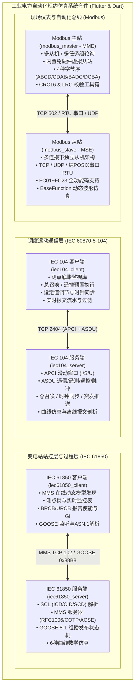

# 工业电力自动化协议仿真系统套件 (Industrial Protocol Simulation Suite)

[](https://flutter.dev)
[](https://dart.dev)
[](https://flutter.dev/desktop)
[](LICENSE)

基于 **Flutter & 纯 Dart** 自主研发的跨平台现代化工业电力自动化规约仿真平台，提供统一的 Material 3 高对比度工业质感桌面 GUI、独立无依赖命令行（CLI）引擎以及全流程自动化闭环自测套件。

本项目通过对电力自动化与工业现场总线主流仿真商业软件进行通信协议拆解与逆向重构，完整覆盖变电站自动化、配电自动化及工业现场总线三大核心通信规约，包含 **4 大核心项目体系（共 6 个全功能子系统）**：

1. **[IEC 60870-5-104 电力远动规约套件](#1-iec-60870-5-104-电力远动规约套件)**：
   - 服务端（RTU / 从站）：[iec104_server](iec104_server)（逆向重构自 `IEC104ServerSimulator`）
   - 客户端（Master / 主站）：[iec104_client](iec104_client)（逆向重构自 `IEC104ClientSimulator`）
2. **[Modbus 现场总线模拟套件](#2-modbus-现场总线模拟套件)**：
   - 从站仿真器（MSE）：[modbus_slave](modbus_slave)（逆向重构自 `ModbusSlaveEmulator (MSE)`）
   - 主站模拟器（MME）：[modbus_master](modbus_master)（逆向重构自 `ModbusMasterEmulator (MME)`）
3. **[IEC 61850 MMS & GOOSE 服务端模拟器](#3-iec-61850-mms--goose-服务端模拟器)**：
   - 服务端仿真器：[iec61850_server](iec61850_server)（逆向重构自 `IEC61850ServerSimulator`）
4. **[IEC 61850 MMS & GOOSE 客户端模拟器](#4-iec-61850-mms--goose-客户端模拟器)**：
   - 客户端模拟器：[iec61850_client](iec61850_client)（逆向重构自 `IEC61850ClientSimulator`）

---

## 🏗️ 整体架构与通信总览



---

## 🌟 四大核心项目系统详解

### 1. IEC 60870-5-104 电力远动规约套件

深度逆向与重构商业版 `IEC104ServerSimulator` 与 `IEC104ClientSimulator`，实现标准电力远动调度主站与子站通信闭环。

- **子工程路径**：
  - 服务端：[iec104_server](iec104_server)
  - 客户端：[iec104_client](iec104_client)
- **协议完整覆盖**：
  - **APCI 链路控制**：I 格式（序号 $N(S), N(R)$ 滑动窗口）、S 格式（监视确认）、U 格式（`STARTDT`, `STOPDT`, `TESTFR` 链路握手，参数 $k, w, t_0..t_3$ 可调）。
  - **监视方向 ASDU**：单/双点遥信（Type 1, 3, 30, 31）、步位置（Type 5, 32）、32位二进制串（Type 7, 33）、归一化/标度化/短浮点遥测（Type 9, 11, 13, 34, 35, 36）、电能量累计量脉冲（Type 15, 37）、初始化结束（Type 70）。
  - **控制方向 ASDU**：单/双命令遥控（Type 45, 46，支持预置选择 Select 与执行 Execute 两步控）、步调节（Type 47）、短浮点设定值（Type 50）、总召唤（Type 100）、电能量召唤（Type 101）、读单点（Type 102）、时钟同步（Type 103，CP56Time2a 绝对时标）。
- **特色功能**：
  - 内置工业级 EaseFunction 曲线发生器，支持遥测正弦波、方波、阶梯波平滑数值变动。
  - Wireshark 级毫秒报文流水查看器与离线原始 16 进制报文解析器（Parser）。

---

### 2. Modbus 现场总线模拟套件

基于商业版 `ModbusSlaveEmulator (MSE)` 与 `ModbusMasterEmulator (MME)` 逆向重构打造，解决传统 Modbus 工具界面陈旧、无法仿真动态波形和配置不灵活的问题。

- **子工程路径**：
  - 从站（MSE）：[modbus_slave](modbus_slave)
  - 主站（MME）：[modbus_master](modbus_master)
- **多连接与层级架构**：
  - **严格按连接组织从站**（`Connection -> Slaves -> Groups`，非全局从站模式），每个物理/网络链路拥有独立的从站地址空间。
  - **全链路通信支持**：
    - **Modbus TCP**（支持多客户端并发连接，默认 502/5020）。
    - **Modbus RTU 物理串口**（基于 Linux POSIX `libc.so.6` FFI 零外部 C 库依赖，支持波特率、数据位、校验位、停止位自定）。
    - **Modbus RTU over TCP**（网络链路承载 CRC-16 串行帧）。
    - **Modbus UDP**（轻量级无连接通讯）。
- **全功能码支持**：
  - 覆盖 FC 01（读线圈）、FC 02（读离散输入）、FC 03（读保持寄存器）、FC 04（读输入寄存器）、FC 05（写单线圈）、FC 06（写单寄存器）、FC 08（诊断）、FC 15（写多线圈）、FC 16（写多寄存器）、FC 17（从机标识）、FC 22（屏蔽写）、FC 23（读写多个寄存器）。
- **动态曲线生成器与波形画布**：
  - 为每个寄存器独立配置缓动算法：正弦波、三角波、方波、锯齿波、累加计数、随机游走、高阶五次方缓动。
  - 内置 Canvas 动态波形实时预览。
- **工业数据处理**：
  - 完整支持 4 种工业字节序：`ABCD` (大端)、`CDAB` (小端字交换)、`BADC` (字节交换)、`DCBA` (小端)。
  - 主站内置**免硬件虚拟从站**、CRC-16 / LRC 计算器及字节序转换工具箱。

---

### 3. IEC 61850 MMS & GOOSE 服务端模拟器

参考商业版 `IEC61850ServerSimulator` 构建的纯 Dart 规约服务端，无需编译任何第三方 C 动态库即可在全平台运行。

- **子工程路径**：[iec61850_server](iec61850_server)
- **全协议栈自研实现**：
  - **Layer 4-7**：RFC 1006 TPKT、ISO 8073 COTP（Class 0 CR/CC/DT）、ISO 8650 ACSE（AARQ/AARE）、ISO 9506 MMS（ASN.1 BER TLV 编解码器）。
  - **MMS 服务**：
    - `GetNameList`：支持 VMD / 域名（Logical Device）作用域查询数据对象与 DataSet。
    - `Read`：单点、批量及 NamedVariableList（DataSet）读取。
    - `Write`：写布尔、整型、浮点、UTC 时标、品质码；支持 `Oper.ctlVal` 与 `SBO` 遥控。
    - `InformationReport`：针对使能的 BRCB/URCB 推送未确认报告（严格遵循 `RptEna` 与 `bufTime` 抑制）。
    - `MMS File Services`：支持 `FileDirectory` 目录查询、`FileOpen` 打开、`FileRead` 分块读取、`FileClose` 关闭、`FileDelete` 删除（用于故障录波 COMTRADE 下载）。
- **GOOSE (IEC 61850-8-1)**：
  - 工业级以太网 EtherType `0x88B8` 报文封装与 `allData` 结构化编码。
  - 支持 `stNum` 状态跳变、`sqNum` 序号递增与**指数退避（Exponential Backoff）重发机制**。
  - 界面一键触发变位快速重发。
- **SCL (IEC 61850-6) XML 快速解析器**：
  - 支持 ICD, CID, SCD, SSD 配置文件；
  - 递归展开 `DataTypeTemplates`（LNodeType, DOType, DAType, EnumType）至具体的叶子数据属性。
  - 内置 9 套标准示例模型（涵盖保护、测量、控制、GOOSE、风电 61400-25、定值切换等）。

---

### 4. IEC 61850 MMS & GOOSE 客户端模拟器

参考商业版 `IEC61850ClientSimulator` 构建的纯 Dart MMS & GOOSE 调试客户端。

- **子工程路径**：[iec61850_client](iec61850_client)
- **多连接管理与持久化**：
  - 顶部多连接下拉切换，支持独立配置 IP、端口、TSAP 与关联离线模型。
  - 配置自动持久化至本地存储。
- **7 大功能模块视图**：
  1. 🌲 **模型浏览器 (Model Explorer)**：树状展开 IED/LD/LN/DO/DA，支持单点详情查询、实时刷新、值修改及 SBO 遥控控制面板（带倒计时锁定与解除）。
  2. 📊 **数据监视表 (Data Monitor)**：测点批量监控表格，支持自定周期轮询、品质码解析 (Good/Invalid/Overflow/Test)、数值变动高亮。
  3. 📑 **报告控制块 (Reports)**：BRCB/URCB 控制块列表，可在线启用/停用 (`RptEna`)、总召唤 (`GI`)、触发选项配置，并提供动态未确认报告接收流 (`InformationReport`) 列表。
  4. 🦢 **GOOSE 报文监视 (GOOSE Monitor)**：捕获局域网 GOOSE 广播报文，展示状态号/顺序号、报文详情与 Raw Hex Dump。
  5. 📁 **定值与文件服务 (Files & Settings)**：浏览并下载变电站远端 COMTRADE 录波文件 (`.cfg`, `.dat`)，切换定值区 (`ActSG`)。
  6. 🌐 **网络报文嗅探 (Traffic Sniffer)**：Wireshark 级别报文记录器，展示时间戳、方向 (TX/RX)、协议分层、服务名称及 Hex + ASCII 双栏对照。
  7. 🛠️ **SCL 离线工具与词典 (SCL Tools & Dictionaries)**：内置 9 套标准 SCL 模型，提供 LN、DO、DA、CDC 中英文双语速查词典。

---

## 📊 子工程与产物矩阵

| 子工程 | 规约角色 | 界面形态 | 独立 CLI 二进制 | 发行包路径 |
| :--- | :--- | :--- | :--- | :--- |
| [iec104_server](iec104_server) | IEC 104 从站 / RTU | Flutter Linux / Web | `build/iec104_server` | `iec104_server/build/linux/x64/release/bundle/` |
| [iec104_client](iec104_client) | IEC 104 主站 / 客户端 | Flutter Linux / Web | `build/iec104_client` | `iec104_client/build/linux/x64/release/bundle/` |
| [modbus_slave](modbus_slave) | Modbus TCP/RTU 从站 | Flutter Linux | 纯 Dart 服务引擎 | `modbus_slave/build/linux/x64/release/bundle/` |
| [modbus_master](modbus_master) | Modbus TCP/RTU 主站 | Flutter Linux | 纯 Dart 虚拟主站 | `modbus_master/build/linux/x64/release/bundle/` |
| [iec61850_server](iec61850_server) | IEC 61850 MMS/GOOSE 从站 | Flutter Linux | `build/iec61850_server_cli` | `iec61850_server/build/linux/x64/release/bundle/` |
| [iec61850_client](iec61850_client) | IEC 61850 MMS/GOOSE 主站 | Flutter Linux | `build/iec61850_client_cli` | `iec61850_client/build/linux/x64/release/bundle/` |

---

## 🧪 自动化测试与联合回环自测体系

各子工程均配备单元测试与全流程端到端闭环自测脚本：

```bash
# 1. IEC 104 主从闭环回环测试
cd iec104_server && dart run bin/verify_features.dart

# 2. Modbus 从站单元与协议测试
cd modbus_slave && flutter test

# 3. IEC 61850 服务端协议套件测试
cd iec61850_server && dart run bin/verify_server.dart

# 4. IEC 61850 客户端与服务端联合回环自测 (13项全功能验证)
cd iec61850_client && dart run bin/verify_client.dart
```

---

## 🚀 快速启动指南

### 1. 运行桌面原生图形界面

确保已安装 Flutter SDK（3.x 及以上），进入任意子工程目录执行：

```bash
# 以运行 IEC 61850 客户端为例
cd iec61850_client
flutter run -d linux
```

### 2. 运行无头服务器 CLI 命令行模式

所有核心工程均支持零图形化无头运行：

```bash
# 启动 IEC 104 服务端
cd iec104_server && dart run bin/server.dart --port 2404

# 启动 IEC 61850 服务端
cd iec61850_server && dart run bin/server.dart --port 102 --scl assets/examples/server_example_basic_io.icd

# 启动 IEC 61850 客户端并自动在线发现模型
cd iec61850_client && dart run bin/client.dart --ip 127.0.0.1 --port 102 --discover
```

### 3. 一键编译所有 Release 发布产物

```bash
# 编译 Linux 桌面端发行包
flutter build linux --release --no-tree-shake-icons

# 编译独立无依赖二进制
dart compile exe bin/server.dart -o build/server_cli
```

---

## 🤖 GitHub Actions 自动化构建与全平台发布

项目已集成基于 GitHub Actions 的多平台矩阵自动化打包流水线（`.github/workflows/release.yml`）：

* **触发方式**：推送 Git Tag（如 `v1.0.0`）或在 GitHub Actions 页面手动点击 **Run workflow**。
* **支持目标**：
  * 🪟 **Windows (x64)**：自动生成一键安装向导 `*-setup.exe`（内置桌面/开始菜单快捷方式与卸载项）及免安装绿色包 `*-windows-x64.zip`。
  * 🍎 **macOS (Apple Silicon & Intel)**：自动生成直接拖拽安装的 `*-macos.dmg` 镜像（已预置网络通信沙箱权限）。
  * 🐧 **Linux (x64 / amd64 & ARM64 / aarch64 多架构)**：生成一键安装的 `*.deb` 安装包（适配 Ubuntu/Debian/统信UOS/银河麒麟）以及通用绿色包 `*-linux-*.tar.gz`。
* **发布产物**：自动汇总并直接附带至 GitHub Releases 页面，同时输出 SHA-256 完整性校验文件。

---

## 📄 许可协议

本项目基于 [MIT 许可证](LICENSE) 开源。
