# Industrial Power Automation Protocol Simulation Suite

[English](README.md) | [简体中文](README_zh.md) | [Deutsch](README_de.md) | [Français](README_fr.md) | [Español](README_es.md) | [日本語](README_ja.md) | [한국어](README_ko.md) | [Русский](README_ru.md) | [العربية](README_ar.md)

[](https://flutter.dev)
[](https://dart.dev)
[](https://flutter.dev/desktop)
[](LICENSE)

A modern, cross-platform industrial power automation protocol simulation suite developed purely in **Flutter & Dart**. It features unified high-contrast Material 3 industrial desktop GUIs, standalone zero-dependency CLI engines, integrated frameless window controls, and end-to-end automated loopback test suites.

By reverse-engineering and modernizing mainstream commercial power automation and fieldbus simulators, this suite comprehensively covers substation automation, distribution automation, and industrial fieldbus protocols across **4 core architectures (6 full-featured subsystems)**:

1. **[IEC 60870-5-104 Telecontrol Protocol Suite](#1-iec-60870-5-104-telecontrol-protocol-suite)**:
   - Server (RTU / Controlled Station): [iec104_server](iec104_server) (Modernized from `IEC104ServerSimulator`)
   - Client (Master / Controlling Station): [iec104_client](iec104_client) (Modernized from `IEC104ClientSimulator`)
2. **[Modbus Fieldbus Simulation Suite](#2-modbus-fieldbus-simulation-suite)**:
   - Slave Simulator (MSE): [modbus_slave](modbus_slave) (Modernized from `ModbusSlaveEmulator (MSE)`)
   - Master Simulator (MME): [modbus_master](modbus_master) (Modernized from `ModbusMasterEmulator (MME)`)
3. **[IEC 61850 MMS & GOOSE Server Simulator](#3-iec-61850-mms--goose-server-simulator)**:
   - Server Simulator: [iec61850_server](iec61850_server) (Modernized from `IEC61850ServerSimulator`)
4. **[IEC 61850 MMS & GOOSE Client Simulator](#4-iec-61850-mms--goose-client-simulator)**:
   - Client Simulator: [iec61850_client](iec61850_client) (Modernized from `IEC61850ClientSimulator`)

---

## 🌐 17-Language Internationalization (i18n)

All 6 applications (IEC 104 Server, IEC 104 Client, Modbus Slave, Modbus Master, IEC 61850 Server, IEC 61850 Client) feature integrated runtime multilingual support using professional industrial automation, SCADA, and power system terminology.

Supported Locales:
- 🇸🇦 **Arabic (ar-SA)** (العربية - with dynamic RTL layout)
- 🇩🇪 **German (de-DE)** (Deutsch)
- 🇺🇸 **English (en-US)** (English - default fallback)
- 🇪🇸 **Spanish (es-ES)** (Español)
- 🇫🇷 **French (fr-FR)** (Français)
- 🇮🇳 **Hindi (hi-IN)** (हिन्दी)
- 🇮🇩 **Indonesian (id-ID)** (Bahasa Indonesia)
- 🇮🇹 **Italian (it-IT)** (Italiano)
- 🇯🇵 **Japanese (ja-JP)** (日本語)
- 🇰🇷 **Korean (ko-KR)** (한국어)
- 🇵🇱 **Polish (pl-PL)** (Polski)
- 🇧🇷 **Portuguese (pt-BR)** (Português do Brasil)
- 🇷🇺 **Russian (ru-RU)** (Русский)
- 🇹🇭 **Thai (th-TH)** (ไทย)
- 🇹🇷 **Turkish (tr-TR)** (Türkçe)
- 🇻🇳 **Vietnamese (vi-VN)** (Tiếng Việt)
- 🇨🇳 **Simplified Chinese (zh-CN)** (简体中文)

> Automatically detects system default language upon startup. Falls back to English (en-US) if the detected system locale is unsupported. Switch languages instantly via the top-right globe button.

---

## 🎨 Unified Frameless Industrial GUI Design

- **Branded Application Icons**: Distinctive protocol icon positioned at the far top-left corner of every application header.
- **Custom Frameless Window Controls**: Native OS title bars hidden; seamless Minimize, Maximize/Restore, and Close buttons smoothly embedded into the top-right toolbar.
- **Draggable Window Bar**: Drag anywhere on the title bar area to reposition the window across monitors.
- **Theme Switching**: Dark / Light high-contrast industrial theme toggle with persistent configuration.

---

## 🖥️ 6-Application Visual Showcase (UI Gallery)

| Subsystem | Protocol Role | UI Screenshot Preview |
| :--- | :--- | :--- |
| **[IEC 104 Server](iec104_server)** | IEC 60870-5-104 Server / RTU | [](iec104_server) |
| **[IEC 104 Client](iec104_client)** | IEC 60870-5-104 Master / SCADA | [](iec104_client) |
| **[Modbus Slave Simulator](modbus_slave)** | Modbus TCP / RTU / UDP Slave (MSE) | [](modbus_slave) |
| **[Modbus Master Simulator](modbus_master)** | Modbus TCP / RTU / UDP Master (MME) | [](modbus_master) |
| **[IEC 61850 Server](iec61850_server)** | IEC 61850 MMS / GOOSE / SCL Server | [](iec61850_server) |
| **[IEC 61850 Client](iec61850_client)** | IEC 61850 Dynamic Discovery & Control | [](iec61850_client) |

---

## 🏗️ Architecture & Communication Overview

```mermaid
flowchart TB
    subgraph Suite["Industrial Power Automation Simulation Suite (Flutter & Dart)"]
        subgraph Substation["Substation Station & Process Level (IEC 61850)"]
            S61850["IEC 61850 Server (iec61850_server)<br/>• SCL (ICD/CID/SCD) Parser<br/>• MMS Server (RFC1006/COTP/ACSE)<br/>• GOOSE 8-1 Multicast State Machine<br/>• 6 Waveform Math Generators"]
            C61850["IEC 61850 Client (iec61850_client)<br/>• Online Dynamic Model Discovery<br/>• Point Tree & Live Monitor Table<br/>• BRCB/URCB Enable & General Interrogation<br/>• GOOSE Sniffer & ASN.1 Parser"]
            C61850 <== "MMS TCP 102 / GOOSE 0x88B8" ==> S61850
        end

        subgraph Telecontrol["Telecontrol & SCADA Level (IEC 60870-5-104)"]
            S104["IEC 104 Server (iec104_server)<br/>• APCI Sliding Window (I/S/U)<br/>• ASDU Telemetry, Teleindication & Control<br/>• General Interrogation / Clock Sync / Spontaneous<br/>• Waveform Sim & Offline Packet Analyzer"]
            C104["IEC 104 Client (iec104_client)<br/>• Live Point Monitor & Station Base<br/>• Interrogation / Select-Before-Operate<br/>• Setpoint Regulation & Clock Sync<br/>• Real-time Traffic Stream & Filtering"]
            C104 <== "TCP 2404 (APCI + ASDU)" ==> S104
        end

        subgraph Fieldbus["Industrial Fieldbus & Sensors (Modbus)"]
            MSlave["Modbus Slave (modbus_slave - MSE)<br/>• Multi-connection Scoped Slave Architecture<br/>• TCP / UDP / Pure POSIX Serial RTU<br/>• FC01~FC23 Full Function Code Support<br/>• EaseFunction Dynamic Waveform Sim"]
            MMaster["Modbus Master (modbus_master - MME)<br/>• Multi-slave / Multi-task Group Polling<br/>• Built-in Hardware-Free Virtual Slave<br/>• 4 Endian Formats (ABCD/CDAB/BADC/DCBA)<br/>• CRC16 & LRC Diagnostic Toolbox"]
            MMaster <== "TCP 502 / RTU Serial / UDP" ==> MSlave
        end
    end
```



---

## 🌟 Core System Specifications

### 1. IEC 60870-5-104 Telecontrol Protocol Suite

Comprehensive reverse engineering and modern reconstruction of `IEC104ServerSimulator` and `IEC104ClientSimulator`, establishing a closed-loop telecontrol SCADA simulation.

- **Project Paths**:
  - Server: [iec104_server](iec104_server)
  - Client: [iec104_client](iec104_client)

#### 📸 Graphical Interface Showcase

##### IEC 104 Server (RTU / Controlled Station Simulator)

> **UI Overview**: Manages multiple listener socket endpoints (e.g. primary/standby port 2404) and station Common Addresses (COA); live APCI parameter tuning ($t_0..t_3$ timers and $k, w$ sliding window acknowledgment); built-in simulation self-test and active client session monitor.

##### IEC 104 Client (Master / Controlling Station Simulator)

> **UI Overview**: Connection alias management and live link telemetry; direct execution of General Interrogation (`C_IC_NA_1`), Clock Synchronization (`C_CS_NA_1`), and Pulse Counter Interrogation; sequence counters and configurable connect-time auto-handshake policies.

- **Protocol Coverage**:
  - **APCI Link Control**: I-Format (Sliding sequence numbers $N(S), N(R)$), S-Format (Supervisory acknowledgment), U-Format (`STARTDT`, `STOPDT`, `TESTFR` link handshakes with configurable parameters $k, w, t_0..t_3$).
  - **Monitoring ASDUs**: Single/Double Point Teleindication (Types 1, 3, 30, 31), Step Position (Types 5, 32), 32-bit Bitstring (Types 7, 33), Normalized/Scaled/Short Floating Point Telemetry (Types 9, 11, 13, 34, 35, 36), Integrated Totals / Pulse Counters (Types 15, 37), End of Initialization (Type 70).
  - **Control ASDUs**: Single/Double Commands (Types 45, 46, supporting Select-Before-Operate two-step control), Step Regulation (Type 47), Setpoint Normalized/Scaled/Float (Types 48, 49, 50), General Interrogation (Type 100), Counter Interrogation (Type 101), Read Command (Type 102), Clock Synchronization (Type 103, CP56Time2a absolute timestamp).
- **Key Features**:
  - Industrial EaseFunction waveform generator for smooth telemetry oscillation (Sine, Triangle, Square, Ramp).
  - Wireshark-grade millisecond traffic log stream and raw hex packet analyzer.

---

### 2. Modbus Fieldbus Simulation Suite

Re-engineered from commercial `ModbusSlaveEmulator (MSE)` and `ModbusMasterEmulator (MME)`, providing dynamic waveform generation, flexible multi-connection grouping, and modern UI.

- **Project Paths**:
  - Slave (MSE): [modbus_slave](modbus_slave)
  - Master (MME): [modbus_master](modbus_master)

#### 📸 Graphical Interface Showcase

##### Modbus Slave Simulator (Modbus Slave Emulator - MSE)

> **UI Overview**: Intuitive data monitor table for coils, discrete inputs, input registers, and holding registers; 16-bit / 32-bit composite data decoding with batch fill dialog; autonomous waveform simulation (Sine, Triangle, Linear Ramp, Random Walk) without external hardware.

##### Modbus Master Simulator (Modbus Master Emulator - MME)

> **UI Overview**: Multi-slave and task-group polling console with single-scan and continuous polling modes; 16-bit binary bitfield expansion for bitwise diagnostics; one-click switching across 4 industrial byte orders: `ABCD`, `CDAB`, `BADC`, and `DCBA`.

- **Multi-Connection & Hierarchical Architecture**:
  - **Strict connection-scoped slaves** (`Connection -> Slaves -> Groups`), ensuring isolated address spaces across independent serial ports and TCP endpoints.
  - **Supported Transports**:
    - **Modbus TCP** (multi-client concurrent listeners, default port 502/5020).
    - **Modbus RTU Serial** (pure POSIX `libc.so.6` FFI without third-party C dependencies; configurable baud rate, data bits, parity, stop bits).
    - **Modbus RTU over TCP** (serial CRC-16 encapsulated over network sockets).
    - **Modbus UDP** (lightweight connectionless transport).
- **Full Function Code Support**:
  - FC 01 (Read Coils), FC 02 (Read Discrete Inputs), FC 03 (Read Holding Registers), FC 04 (Read Input Registers), FC 05 (Write Single Coil), FC 06 (Write Single Register), FC 08 (Diagnostics), FC 15 (Write Multiple Coils), FC 16 (Write Multiple Registers), FC 17 (Report Slave ID), FC 22 (Mask Write Register), FC 23 (Read/Write Multiple Registers).
- **Dynamic Waveform Generation**:
  - Independent easing algorithm per register: Sine, Triangle, Square, Sawtooth, Linear Counter, Random Walk, Quintic Ease.
  - Live Canvas waveform rendering.
- **Data Representation & Byte Order**:
  - Supports 4 industrial word/byte combinations: `ABCD` (Big Endian), `CDAB` (Little Endian Word Swap), `BADC` (Byte Swap), `DCBA` (Little Endian).
  - Built-in hardware-free virtual slave, CRC-16 / LRC calculation tools, and endian converter.

---

### 3. IEC 61850 MMS & GOOSE Server Simulator

Pure Dart implementation modeled after commercial `IEC61850ServerSimulator`, running natively across desktop and server environments without compiling native C libraries.

- **Project Path**: [iec61850_server](iec61850_server)

#### 📸 Graphical Interface Showcase


> **UI Overview**: SCL data model tree and rapid search bar; centralized DO/DA live value monitor with Quality bits, timestamp, and mathematical waveform generator; integrated substation SCL hierarchy view and Common Data Class (CDC) metadata dictionary.

- **Protocol Stack Implementation**:
  - **Layers 4-7**: RFC 1006 TPKT, ISO 8073 COTP (Class 0 CR/CC/DT), ISO 8650 ACSE (AARQ/AARE), ISO 9506 MMS (ASN.1 BER TLV codec).
  - **MMS Services**: `GetNameList`, `Read`, `Write`, `InformationReport`, `MMS File Services` (`FileDirectory`, `FileOpen`, `FileRead`, `FileClose`, `FileDelete` for COMTRADE fault recorder retrieval).
- **GOOSE (IEC 61850-8-1)**:
  - Ethernet EtherType `0x88B8` structured frame encapsulation.
  - `stNum` state changes, `sqNum` sequence increments, and **exponential backoff retransmission**.
- **SCL (IEC 61850-6) XML Engine**:
  - Fast parsing for ICD, CID, SCD, and SSD configurations.
  - Recursive expansion of `DataTypeTemplates` (LNodeType, DOType, DAType, EnumType).
  - 9 bundled industry-standard sample models (Protection, Measurement, Control, GOOSE, Wind 61400-25, etc.).

---

### 4. IEC 61850 MMS & GOOSE Client Simulator

Pure Dart MMS & GOOSE engineering client modeled after `IEC61850ClientSimulator`.

- **Project Path**: [iec61850_client](iec61850_client)

#### 📸 Graphical Interface Showcase


> **UI Overview**: Substation model Online Discovery; hierarchical IED model tree and FC functional constraints; real-time point polling and SBO control panel with timeout safety locks; BRCB/URCB report management and LAN GOOSE sniffer.

- **7 Core Application Views**:
  1. 🌲 **Model Explorer**: Hierarchical IED/LD/LN/DO/DA tree inspection, value mutation, and SBO control panel.
  2. 📊 **Data Monitor**: Periodic polling table with IEC 61850 quality flag inspection and value change highlighting.
  3. 📑 **Report Control Blocks**: BRCB/URCB list with online enablement (`RptEna`), general interrogation (`GI`), and live `InformationReport` feed.
  4. 🦢 **GOOSE Monitor**: Capture and decode local network GOOSE multicasts with state counter and raw hex dump.
  5. 📁 **Files & Settings**: Browse and download remote COMTRADE waveform records (`.cfg`, `.dat`), switch active setting groups (`ActSG`).
  6. 🌐 **Traffic Sniffer**: Wireshark-level packet capture with protocol layers, service names, and split Hex+ASCII display.
  7. 🛠️ **SCL Tools & Dictionaries**: 9 bundled SCL templates, plus bilingual reference dictionary for LN, DO, DA, and CDC.

---

## 📊 Subproject & Artifact Matrix

| Subproject | Protocol Role | GUI / Presentation | Standalone CLI Binary | Release Path |
| :--- | :--- | :--- | :--- | :--- |
| [iec104_server](iec104_server) | IEC 104 Server / RTU | Flutter Desktop / Web | `build/iec104_server` | `iec104_server/build/linux/x64/release/bundle/` |
| [iec104_client](iec104_client) | IEC 104 Client / Master | Flutter Desktop / Web | `build/iec104_client` | `iec104_client/build/linux/x64/release/bundle/` |
| [modbus_slave](modbus_slave) | Modbus TCP/RTU Slave | Flutter Desktop | Pure Dart Engine | `modbus_slave/build/linux/x64/release/bundle/` |
| [modbus_master](modbus_master) | Modbus TCP/RTU Master | Flutter Desktop | Pure Dart Virtual Master | `modbus_master/build/linux/x64/release/bundle/` |
| [iec61850_server](iec61850_server) | IEC 61850 MMS/GOOSE Server | Flutter Desktop | `build/iec61850_server_cli` | `iec61850_server/build/linux/x64/release/bundle/` |
| [iec61850_client](iec61850_client) | IEC 61850 MMS/GOOSE Client | Flutter Desktop | `build/iec61850_client_cli` | `iec61850_client/build/linux/x64/release/bundle/` |

---

## 🧪 Automated Testing & Verification

Each subproject includes comprehensive unit, widget, and loopback verification suites:

```bash
# 1. IEC 104 Server & Client Test
cd iec104_server && flutter test
cd iec104_client && flutter test

# 2. Modbus Slave & Master Test
cd modbus_slave && flutter test
cd modbus_master && flutter test

# 3. IEC 61850 Protocol Tests
cd iec61850_server && dart run bin/verify_server.dart
cd iec61850_client && dart run bin/verify_client.dart
```

---

## 🚀 Quick Start Guide

### 1. Run Desktop GUI

Ensure Flutter SDK (3.x+) is installed:

```bash
# Example: Launch Modbus Master
cd modbus_master
flutter run -d linux # or -d windows, -d macos
```

### 2. Run Headless CLI Mode

```bash
# Start IEC 104 Server headless
cd iec104_server && dart run bin/server.dart --port 2404

# Start IEC 61850 Server headless
cd iec61850_server && dart run bin/server.dart --port 102 --scl assets/examples/server_example_basic_io.icd
```

---

## 🤖 GitHub Actions Automated Cross-Platform Release

Integrated multi-platform automated CI/CD pipeline (`.github/workflows/release.yml`):

* **Triggers**: Push Git Tag (e.g. `v1.0.0`) or manually click **Run workflow**.
* **Target Platforms**:
  * 🪟 **Windows (x64)**: `*-setup.exe` installer wizard + portable `*-windows-x64.zip`.
  * 🍎 **macOS (Apple Silicon & Intel)**: `*-macos.dmg` drag-and-drop installer.
  * 🐧 **Linux (x64 / amd64 & ARM64)**: `*.deb` packages + portable `*-linux-*.tar.gz`.

---

## 📄 License

This project is licensed under the [MIT License](LICENSE).
