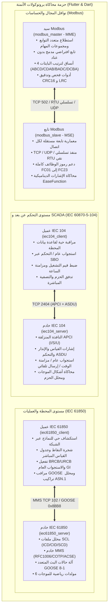

# حزمة محاكاة بروتوكولات أتمتة الطاقة الصناعية (Industrial Power Automation Protocol Simulation Suite)

[English](README.md) | [简体中文](README_zh.md) | [Deutsch](README_de.md) | [Français](README_fr.md) | [Español](README_es.md) | [日本語](README_ja.md) | [한국어](README_ko.md) | [Русский](README_ru.md) | [العربية](README_ar.md)

[](https://flutter.dev)
[](https://dart.dev)
[](https://flutter.dev/desktop)
[](LICENSE)

منظومة حديثة ومتكاملة متعددة المنصات لمحاكاة بروتوكولات الاتصالات في محطات التحويل الكهربائية وشبكات التوزيع ونواقل المجال الصناعية، تم تطويرها بالكامل باستخدام **Flutter و Dart**. تتميز بواجهة سطح مكتب صناعية عالية التباين بتصميم Material 3، ومحركات سطر أوامر (CLI) مستقلة دون أي تبعيات خارجية، والتحكم السلس بالنوافذ بدون إطارات، وحزم اختبارات مغلقة الحلقة مؤتمتة بالكامل.

من خلال الهندسة العكسية وإعادة بناء برمجيات المحاكاة التجارية الرائدة، تغطي هذه الحزمة بروتوكولات الأتمتة عبر **4 معماريات رئيسية (بإجمالي 6 أنظمة فرعية متكاملة)**:

1. **[حزمة بروتوكول التحكم عن بعد IEC 60870-5-104](#1-حزمة-بروتوكول-التحكم-عن-بعد-iec-60870-5-104)**:
   - الخادم (RTU / المحطة التابعة): [iec104_server](iec104_server) (معاد بناؤه من `IEC104ServerSimulator`)
   - العميل (Master / مركز التحكم SCADA): [iec104_client](iec104_client) (معاد بناؤه من `IEC104ClientSimulator`)
2. **[حزمة محاكاة ناقل المجال Modbus](#2-حزمة-محاكاة-ناقل-المجال-modbus)**:
   - محاكي التابع (MSE): [modbus_slave](modbus_slave) (معاد بناؤه من `ModbusSlaveEmulator`)
   - محاكي السيد (MME): [modbus_master](modbus_master) (معاد بناؤه من `ModbusMasterEmulator`)
3. **[محاكي خادم IEC 61850 MMS & GOOSE](#3-محاكي-خادم-iec-61850-mms--goose)**:
   - خادم المحاكاة: [iec61850_server](iec61850_server) (معاد بناؤه من `IEC61850ServerSimulator`)
4. **[محاكي عميل IEC 61850 MMS & GOOSE](#4-محاكي-عميل-iec-61850-mms--goose)**:
   - عميل الفحص والاختبار: [iec61850_client](iec61850_client) (معاد بناؤه من `IEC61850ClientSimulator`)

---

## 🌐 التدويل والدعم اللغوي بـ 17 لغة عالمية (i18n)

تدعم جميع التطبيقات الستة التبديل الفوري للغات أثناء التشغيل مع استخدام المصطلحات المهنية القياسية في هندسة القوى الكهربائية وأنظمة SCADA و IEC 61850:

قائمة اللغات المدعومة:
- 🇸🇦 **العربية (ar-SA)** (العربية - مع تخطيط مرآتي ديناميكي من اليمين إلى اليسار RTL)
- 🇩🇪 **الألمانية (de-DE)** (Deutsch)
- 🇺🇸 **الإنجليزية (en-US)** (English - اللغة الافتراضية)
- 🇪🇸 **الإسبانية (es-ES)** (Español)
- 🇫🇷 **الفرنسية (fr-FR)** (Français)
- 🇮🇳 **الهندية (hi-IN)** (हिन्दी)
- 🇮🇩 **الإندونيسية (id-ID)** (Bahasa Indonesia)
- 🇮🇹 **الإيطالية (it-IT)** (Italiano)
- 🇯🇵 **اليابانية (ja-JP)** (日本語)
- 🇰🇷 **الكورية (ko-KR)** (한국어)
- 🇵🇱 **البولندية (pl-PL)** (Polski)
- 🇧🇷 **البرتغالية (pt-BR)** (Português do Brasil)
- 🇷🇺 **الروسية (ru-RU)** (Русский)
- 🇹🇭 **التايلاندية (th-TH)** (ไทย)
- 🇹🇷 **التركية (tr-TR)** (Türkçe)
- 🇻🇳 **الفيتنامية (vi-VN)** (Tiếng Việt)
- 🇨🇳 **الصينية المبسطة (zh-CN)** (简体中文)

---

## 🎨 تصميم واجهة مكتب صناعية مدمجة بدون إطارات

- **أيقونات مميزة للتطبيقات**: شعار خاص لكل بروتوكول في الزاوية العلوية اليسرى.
- **عناصر تحكم بالنوافذ مدمجة**: إخفاء إطارات نظام التشغيل القياسية وتضمين أزرار التصغير والتكبير والإغلاق بسلاسة داخل شريط الأدوات.
- **شريط عنوان قابل للسحب**: سحب حر وسلس عبر الشاشات المتعددة.
- **السمات الداكنة والفاتحة**: تبديل فوري بين النمط الصناعي الداكن والنمط الفاتح المكتبي مع حفظ الإعدادات تلقائياً.

---

## 🖥️ معرض واجهات التطبيقات الستة (UI Showcase)

| النظام الفرعي | دور البروتوكول | معاينة واجهة المستخدم |
| :--- | :--- | :--- |
| **[خادم IEC 104](iec104_server)** | خادم IEC 60870-5-104 / محطة RTU | [](iec104_server) |
| **[عميل IEC 104](iec104_client)** | سيد IEC 60870-5-104 / مركز تحكم SCADA | [](iec104_client) |
| **[محاكي تابع Modbus](modbus_slave)** | تابع Modbus TCP / RTU / UDP (MSE) | [](modbus_slave) |
| **[محاكي سيد Modbus](modbus_master)** | سيد Modbus TCP / RTU / UDP (MME) | [](modbus_master) |
| **[خادم IEC 61850](iec61850_server)** | خادم IEC 61850 MMS / GOOSE / SCL | [](iec61850_server) |
| **[عميل IEC 61850](iec61850_client)** | استكشاف نماذج واختبار IEC 61850 | [](iec61850_client) |

---

## 🏗️ الهيكلية العامة ونظرة شاملة على الاتصالات



---

## 🌟 المواصفات الفنية للأنظمة الرئيسية

### 1. حزمة بروتوكول التحكم عن بعد IEC 60870-5-104

- **مسارات المشاريع الفرعية**:
  - الخادم: [iec104_server](iec104_server)
  - العميل: [iec104_client](iec104_client)

#### 📸 معاينة واجهة المستخدم

##### خادم IEC 104 (محاكي RTU / المحطة التابعة)

> **نظرة عامة**: إدارة مقابس الاستماع المتعددة (المنفذ 2404 للخطين الأساسي والاحتياطي)، إدارة عناوين المحطات المشتركة (COA)، وضبط توقيتات APCI ($t_0..t_3, k, w$) والاختبار الذاتي المدمج.

##### عميل IEC 104 (محاكي السيد / مركز تحكم SCADA)

> **نظرة عامة**: إدارة أسماء الاتصالات وحالة الاتصال المباشرة، إرسال الاستجواب العام بنقرة واحدة (`C_IC_NA_1`)، مزامنة الوقت (`C_CS_NA_1`)، واستدعاء عدادات الطاقة وسياسات الاتصال الآلي.

---

### 2. حزمة محاكاة ناقل المجال Modbus

- **مسارات المشاريع الفرعية**:
  - التابع (MSE): [modbus_slave](modbus_slave)
  - السيد (MME): [modbus_master](modbus_master)

#### 📸 معاينة واجهة المستخدم

##### محاكي تابع Modbus (MSE)

> **نظرة عامة**: جدول مراقبة الملفات والمدخلات الرقمية وسجلات الإدخال وسجلات الحفظ؛ مولد إشارات موجية ديناميكية رياضية (جيبية، مثلثية، تزايدية، خطوة عشوائية).

##### محاكي سيد Modbus (MME)

> **نظرة عامة**: منصة استطلاع متعدد التوابع للمسح الدوري والفردي، عرض بتات ثنائية 16-بت للتشخيص التفصيلي، والتحويل الفوري بين 4 أنساق لترتيب البايتات (`ABCD`, `CDAB`, `BADC`, `DCBA`).

---

### 3. محاكي خادم IEC 61850 MMS & GOOSE

- **مسار المشروع الفرعي**: [iec61850_server](iec61850_server)

#### 📸 معاينة واجهة المستخدم


> **نظرة عامة**: شجرة هيكل نموذج SCL (IED/LD/LN/DO/DA)، مراقبة القيم المباشرة مع بتات الجودة (Quality) والأختام الزمنية، محاكاة الموجات وقاموس CDC القياسي لمحطات التحويل.

---

### 4. محاكي عميل IEC 61850 MMS & GOOSE

- **مسار المشروع الفرعي**: [iec61850_client](iec61850_client)

#### 📸 معاينة واجهة المستخدم


> **نظرة عامة**: الاكتشاف الذاتي لنماذج المحطات عبر الشبكة (Online Discovery)، لوحة التحكم عن بعد SBO، إدارة كتل التقارير BRCB/URCB ومراقب حزم GOOSE المباشر.

---

## 📊 مصفوفة المشاريع الفرعية ومخرجات البناء

| المشروع الفرعي | الدور البروتوكولي | النمط | ملف CLI الثنائي المستقل | مسار حزمة الإصدار |
| :--- | :--- | :--- | :--- | :--- |
| [iec104_server](iec104_server) | خادم IEC 104 / RTU | Flutter Desktop / Web | `build/iec104_server` | `iec104_server/build/linux/x64/release/bundle/` |
| [iec104_client](iec104_client) | عميل IEC 104 / SCADA | Flutter Desktop / Web | `build/iec104_client` | `iec104_client/build/linux/x64/release/bundle/` |
| [modbus_slave](modbus_slave) | تابع Modbus TCP/RTU | Flutter Desktop | محرك Dart نقي | `modbus_slave/build/linux/x64/release/bundle/` |
| [modbus_master](modbus_master) | سيد Modbus TCP/RTU | Flutter Desktop | سيد افتراضي Dart نقي | `modbus_master/build/linux/x64/release/bundle/` |
| [iec61850_server](iec61850_server) | خادم IEC 61850 | Flutter Desktop | `build/iec61850_server_cli` | `iec61850_server/build/linux/x64/release/bundle/` |
| [iec61850_client](iec61850_client) | عميل IEC 61850 | Flutter Desktop | `build/iec61850_client_cli` | `iec61850_client/build/linux/x64/release/bundle/` |

---

## 🚀 دليل البدء السريع

```bash
# 1. تشغيل واجهة سطح المكتب (مثال: Modbus Master)
cd modbus_master
flutter run -d linux

# 2. تشغيل وضع سطر الأوامر بدون واجهة رسومية (مثال: IEC 104 Server)
cd iec104_server && dart run bin/server.dart --port 2404
```

---

## 📄 رخصة الاستخدام

هذا المشروع مرخص بموجب [رخصة MIT](LICENSE).
