# Industrielle Strom- und Automatisierungsprotokoll-Simulationssuite

[English](README.md) | [简体中文](README_zh.md) | [Deutsch](README_de.md) | [Français](README_fr.md) | [Español](README_es.md) | [日本語](README_ja.md) | [한국어](README_ko.md) | [Русский](README_ru.md) | [العربية](README_ar.md)

[](https://flutter.dev)
[](https://dart.dev)
[](https://flutter.dev/desktop)
[](LICENSE)

Eine moderne, plattformübergreifende Simulationssuite für industrielle Energieautomatisierungsprotokolle, vollständig entwickelt mit **Flutter & Dart**. Sie bietet einheitliche, kontrastreiche Material 3-Desktop-GUIs im Industrie-Design, eigenständige, abhängigkeitsfreie CLI-Engines, integrierte rahmenlose Fenstersteuerung und automatisierte End-to-End-Loopback-Testsuiten.

Durch Reverse-Engineering und Modernisierung gängiger kommerzieller Stromautomatisierungs- und Feldbussimulatoren deckt diese Suite die Stationsautomatisierung, Verteilungsautomatisierung und industrielle Feldbusprotokolle in **4 Kernarchitekturen (6 voll funktionsfähigen Subsystemen)** umfassend ab:

1. **[IEC 60870-5-104 Fernwirkprotokoll-Suite](#1-iec-60870-5-104-fernwirkprotokoll-suite)**:
   - Server (RTU / Unterstation): [iec104_server](iec104_server) (Modernisiert von `IEC104ServerSimulator`)
   - Client (Master / Leitstelle): [iec104_client](iec104_client) (Modernisiert von `IEC104ClientSimulator`)
2. **[Modbus Feldbus-Simulationssuite](#2-modbus-feldbus-simulationssuite)**:
   - Slave-Simulator (MSE): [modbus_slave](modbus_slave) (Modernisiert von `ModbusSlaveEmulator`)
   - Master-Simulator (MME): [modbus_master](modbus_master) (Modernisiert von `ModbusMasterEmulator`)
3. **[IEC 61850 MMS & GOOSE Server-Simulator](#3-iec-61850-mms--goose-server-simulator)**:
   - Server-Simulator: [iec61850_server](iec61850_server) (Modernisiert von `IEC61850ServerSimulator`)
4. **[IEC 61850 MMS & GOOSE Client-Simulator](#4-iec-61850-mms--goose-client-simulator)**:
   - Client-Simulator: [iec61850_client](iec61850_client) (Modernisiert von `IEC61850ClientSimulator`)

---

## 🌐 Internationalisierung in 17 Sprachen (i18n)

Alle 6 Anwendungen verfügen über integrierte mehrsprachige Unterstützung zur Laufzeit mit standardisierter industrieller Energieautomatisierungs- und SCADA-Terminologie:

Unterstützte Sprachen:
- 🇸🇦 **Arabisch (ar-SA)** (العربية - mit dynamischem RTL-Layout)
- 🇩🇪 **Deutsch (de-DE)** (Deutsch)
- 🇺🇸 **Englisch (en-US)** (English - Standard-Fallback)
- 🇪🇸 **Spanisch (es-ES)** (Español)
- 🇫🇷 **Französisch (fr-FR)** (Français)
- 🇮🇳 **Hindi (hi-IN)** (हिन्दी)
- 🇮🇩 **Indonesisch (id-ID)** (Bahasa Indonesia)
- 🇮🇹 **Italienisch (it-IT)** (Italiano)
- 🇯🇵 **Japanisch (ja-JP)** (日本語)
- 🇰🇷 **Koreanisch (ko-KR)** (한국어)
- 🇵🇱 **Polnisch (pl-PL)** (Polski)
- 🇧🇷 **Portugiesisch (pt-BR)** (Português do Brasil)
- 🇷🇺 **Russisch (ru-RU)** (Русский)
- 🇹🇭 **Thailändisch (th-TH)** (ไทย)
- 🇹🇷 **Türkisch (tr-TR)** (Türkçe)
- 🇻🇳 **Vietnamesisch (vi-VN)** (Tiếng Việt)
- 🇨🇳 **Vereinfachtes Chinesisch (zh-CN)** (简体中文)

---

## 🎨 Einheitliches rahmenloses industrielles GUI-Design

- **Individuelle App-Icons**: Spezifische Protokoll-Logos oben links im Fensterkopf jeder Anwendung.
- **Nahtlose Fenstersteuerung**: Native Titelleisten ausgeblendet; Minimiere-, Maximiere-/Wiederherstellen- und Schließen-Schaltflächen sind nahtlos in die Symbolleiste integriert.
- **Frei verschiebbare Titelleiste**: Beliebiges Verschieben des Fensters über Multi-Monitor-Setups hinweg.
- **Kontrastreiches Theme**: Umschaltung zwischen Dark- und Light-Modus mit automatischer Konfigurationsspeicherung.

---

## 🖥️ 6-Anwendungs-Galerie (UI Showcase)

| Subsystem | Protokollrolle | GUI-Vorschau |
| :--- | :--- | :--- |
| **[IEC 104 Server](iec104_server)** | IEC 60870-5-104 Server / RTU | [](iec104_server) |
| **[IEC 104 Client](iec104_client)** | IEC 60870-5-104 Master / Leitstelle | [](iec104_client) |
| **[Modbus Slave Simulator](modbus_slave)** | Modbus TCP / RTU / UDP Slave (MSE) | [](modbus_slave) |
| **[Modbus Master Simulator](modbus_master)** | Modbus TCP / RTU / UDP Master (MME) | [](modbus_master) |
| **[IEC 61850 Server](iec61850_server)** | IEC 61850 MMS / GOOSE / SCL Server | [](iec61850_server) |
| **[IEC 61850 Client](iec61850_client)** | IEC 61850 Modellentdeckung & Diagnose | [](iec61850_client) |

---

## 🏗️ Architektur & Kommunikationsübersicht

```mermaid
flowchart TB
    subgraph Suite["Industrielle Simulationssuite (Flutter & Dart)"]
        subgraph Substation["Stations- & Prozessebene (IEC 61850)"]
            S61850["IEC 61850 Server (iec61850_server)<br/>• SCL (ICD/CID/SCD) Parser<br/>• MMS Server (RFC1006/COTP/ACSE)<br/>• GOOSE 8-1 Multicast Zustandsautomat<br/>• 6 Mathematische Wellenformgeneratoren"]
            C61850["IEC 61850 Client (iec61850_client)<br/>• Dynamische Online-Modellentdeckung<br/>• Messpunktbaum & Live-Monitortabelle<br/>• BRCB/URCB Aktivierung & Generalabfrage<br/>• GOOSE Sniffer & ASN.1 Parser"]
            C61850 <== "MMS TCP 102 / GOOSE 0x88B8" ==> S61850
        end

        subgraph Telecontrol["Fernwirk- & SCADA-Ebene (IEC 60870-5-104)"]
            S104["IEC 104 Server (iec104_server)<br/>• APCI Schiebefenster (I/S/U)<br/>• ASDU Telemetrie, Meldungen & Steuerung<br/>• Generalabfrage / Zeitsynchronisation<br/>• Signalformsimulation & Offline-Paketanalysator"]
            C104["IEC 104 Client (iec104_client)<br/>• Messpunkt-Liveüberwachung<br/>• Generalabfrage / Select-Before-Operate<br/>• Sollwertregelung & Zeitsynchronisation<br/>• Echtzeit-Paketstrom & Filterung"]
            C104 <== "TCP 2404 (APCI + ASDU)" ==> S104
        end

        subgraph Fieldbus["Feldbus & Sensoren (Modbus)"]
            MSlave["Modbus Slave (modbus_slave - MSE)<br/>• Verbindungsbasierte Slave-Architektur<br/>• TCP / UDP / Reine POSIX Serielle RTU<br/>• FC01~FC23 Vollständige Funktionscodes<br/>• EaseFunction Dynamische Signalverlaufssimulation"]
            MMaster["Modbus Master (modbus_master - MME)<br/>• Multi-Slave / Multi-Task-Polling<br/>• Integrierter hardwarefreier virtueller Slave<br/>• 4 Byte-Reihenfolgen (ABCD/CDAB/BADC/DCBA)<br/>• CRC16- & LRC-Diagnosewerkzeuge"]
            MMaster <== "TCP 502 / RTU Seriell / UDP" ==> MSlave
        end
    end
```



---

## 🌟 Kernsystem-Spezifikationen

### 1. IEC 60870-5-104 Fernwirkprotokoll-Suite

Modernisierte Rekonstruktion kommerzieller Simulatoren für geschlossene Fernwirk- und Leitstellenkommunikation.

- **Projektpfade**:
  - Server: [iec104_server](iec104_server)
  - Client: [iec104_client](iec104_client)

#### 📸 Benutzeroberflächen-Vorschau

##### IEC 104 Server (RTU / Unterstationssimulator)

> **Übersicht**: Verwaltung mehrerer Socket-Listener-Instanzen (z. B. Port 2404 Haupt-/Ersatzleitung), Stations-Gemeinschaftsadressen (COA), APCI-Verbindungsparameter ($t_0..t_3, k, w$) und integrierter Selbsttest.

##### IEC 104 Client (Master / Leitstellen-Simulator)

> **Übersicht**: Verbindungsalias-Verwaltung, Generalabfrage (`C_IC_NA_1`), Uhrzeitsynchronisation (`C_CS_NA_1`), Zählerabfrage und automatische Verbindungsaufbau-Strategien.

---

### 2. Modbus Feldbus-Simulationssuite

Komplette Neuentwicklung von `ModbusSlaveEmulator` und `ModbusMasterEmulator` mit dynamischer Signalgenerierung und Mehrverbindungs-Hierarchie.

- **Projektpfade**:
  - Slave (MSE): [modbus_slave](modbus_slave)
  - Master (MME): [modbus_master](modbus_master)

#### 📸 Benutzeroberflächen-Vorschau

##### Modbus Slave Simulator (MSE)

> **Übersicht**: Live-Monitortabelle für Coils, Diskrete Eingänge, Eingangs- und Haltregister; EaseFunction-Signalformengenerator (Sinus, Dreieck, Rampe, Random Walk).

##### Modbus Master Simulator (MME)

> **Übersicht**: Multi-Slave- und Aufgaben-Polling, 16-Bit-Binärbit-Diagnoseanzeige und Umschaltung zwischen 4 Byte-Reihenfolgen (`ABCD`, `CDAB`, `BADC`, `DCBA`).

---

### 3. IEC 61850 MMS & GOOSE Server-Simulator

Reine Dart-Implementierung nach dem Vorbild von `IEC61850ServerSimulator` ohne externe C-Bibliotheken.

- **Projektpfad**: [iec61850_server](iec61850_server)

#### 📸 Benutzeroberflächen-Vorschau


> **Übersicht**: SCL-Modellbaum (IED/LD/LN/DO/DA), Echtzeit-Datenüberwachung mit Qualitätsbits und Zeitstempeln, Signalformensimulation und CDC-Metadatenlexikon.

---

### 4. IEC 61850 MMS & GOOSE Client-Simulator

Diagnose- und Test-Client für IEC 61850 Stationsautomatisierung.

- **Projektpfad**: [iec61850_client](iec61850_client)

#### 📸 Benutzeroberflächen-Vorschau


> **Übersicht**: Online-Modellentdeckung, Echtzeit-Messpunktabfrage, Select-Before-Operate (SBO) Fernsteuerungsdialoge, BRCB/URCB-Berichtsverwaltung und GOOSE-Sniffer.

---

## 📊 Teilprojekte & Artefakte-Matrix

| Teilprojekt | Protokollrolle | GUI-Präsentation | Standalone-CLI-Binärdatei | Release-Pfad |
| :--- | :--- | :--- | :--- | :--- |
| [iec104_server](iec104_server) | IEC 104 Server / RTU | Flutter Desktop / Web | `build/iec104_server` | `iec104_server/build/linux/x64/release/bundle/` |
| [iec104_client](iec104_client) | IEC 104 Client / Master | Flutter Desktop / Web | `build/iec104_client` | `iec104_client/build/linux/x64/release/bundle/` |
| [modbus_slave](modbus_slave) | Modbus TCP/RTU Slave | Flutter Desktop | Reines Dart | `modbus_slave/build/linux/x64/release/bundle/` |
| [modbus_master](modbus_master) | Modbus TCP/RTU Master | Flutter Desktop | Reines Dart | `modbus_master/build/linux/x64/release/bundle/` |
| [iec61850_server](iec61850_server) | IEC 61850 MMS/GOOSE Server | Flutter Desktop | `build/iec61850_server_cli` | `iec61850_server/build/linux/x64/release/bundle/` |
| [iec61850_client](iec61850_client) | IEC 61850 MMS/GOOSE Client | Flutter Desktop | `build/iec61850_client_cli` | `iec61850_client/build/linux/x64/release/bundle/` |

---

## 🚀 Schnellstartanleitung

```bash
# 1. Starten der Desktop-GUI (Beispiel Modbus Master)
cd modbus_master
flutter run -d linux

# 2. Starten im Headless-CLI-Modus (Beispiel IEC 104 Server)
cd iec104_server && dart run bin/server.dart --port 2404
```

---

## 📄 Lizenz

Dieses Projekt steht unter der [MIT-Lizenz](LICENSE).
