# Suite de Simulación de Protocolos de Automatización Eléctrica Industrial

[English](README.md) | [简体中文](README_zh.md) | [Deutsch](README_de.md) | [Français](README_fr.md) | [Español](README_es.md) | [日本語](README_ja.md) | [한국어](README_ko.md) | [Русский](README_ru.md) | [العربية](README_ar.md)

[](https://flutter.dev)
[](https://dart.dev)
[](https://flutter.dev/desktop)
[](LICENSE)

Una moderna suite multiplataforma para la simulación de protocolos de automatización de energía eléctrica, desarrollada íntegramente en **Flutter & Dart**. Ofrece interfaces gráficas de escritorio Material 3 de alto contraste y estética industrial, motores de línea de comandos (CLI) autónomos y sin dependencias externas, controles de ventana personalizados sin marco y suites de pruebas automatizadas en bucle cerrado.

A través de la ingeniería inversa y la modernización de los principales simuladores comerciales de automatización eléctrica y buses de campo, este paquete cubre la automatización de subestaciones, la distribución de energía y los buses industriales en **4 arquitecturas fundamentales (6 subsistemas completos)**:

1. **[Suite de Telecontrol IEC 60870-5-104](#1-suite-de-telecontrol-iec-60870-5-104)**:
   - Servidor (RTU / Estación controlada): [iec104_server](iec104_server) (Modernizado de `IEC104ServerSimulator`)
   - Cliente (Maestro / Estación de control SCADA): [iec104_client](iec104_client) (Modernizado de `IEC104ClientSimulator`)
2. **[Suite de Bus de Campo Modbus](#2-suite-de-bus-de-campo-modbus)**:
   - Simulador Esclavo (MSE): [modbus_slave](modbus_slave) (Modernizado de `ModbusSlaveEmulator`)
   - Simulador Maestro (MME): [modbus_master](modbus_master) (Modernizado de `ModbusMasterEmulator`)
3. **[Simulador Servidor IEC 61850 MMS & GOOSE](#3-simulador-servidor-iec-61850-mms--goose)**:
   - Servidor IEC 61850: [iec61850_server](iec61850_server) (Modernizado de `IEC61850ServerSimulator`)
4. **[Simulador Cliente IEC 61850 MMS & GOOSE](#4-simulador-cliente-iec-61850-mms--goose)**:
   - Cliente IEC 61850: [iec61850_client](iec61850_client) (Modernizado de `IEC61850ClientSimulator`)

---

## 🌐 Internacionalización en 17 Idiomas (i18n)

Las 6 aplicaciones cuentan con soporte multilingüe dinámico en tiempo de ejecución con terminología técnica estándar de SCADA y automatización de sistemas de potencia:

Idiomas soportados:
- 🇸🇦 **Árabe (ar-SA)** (العربية - con diseño RTL dinámico)
- 🇩🇪 **Alemán (de-DE)** (Deutsch)
- 🇺🇸 **Inglés (en-US)** (English - idioma predeterminado)
- 🇪🇸 **Español (es-ES)** (Español)
- 🇫🇷 **Francés (fr-FR)** (Français)
- 🇮🇳 **Hindi (hi-IN)** (हिन्दी)
- 🇮🇩 **Indonesio (id-ID)** (Bahasa Indonesia)
- 🇮🇹 **Italiano (it-IT)** (Italiano)
- 🇯🇵 **Japonés (ja-JP)** (日本語)
- 🇰🇷 **Coreano (ko-KR)** (한국어)
- 🇵🇱 **Polaco (pl-PL)** (Polski)
- 🇧🇷 **Portugués (pt-BR)** (Português do Brasil)
- 🇷🇺 **Ruso (ru-RU)** (Русский)
- 🇹🇭 **Tailandés (th-TH)** (ไทย)
- 🇹🇷 **Turco (tr-TR)** (Türkçe)
- 🇻🇳 **Vietnamita (vi-VN)** (Tiếng Việt)
- 🇨🇳 **Chino simplificado (zh-CN)** (简体中文)

---

## 🎨 Diseño de Interfaz Gráfica Industrial sin Marcos

- **Iconos de Marca de Aplicación**: Logotipo característico de cada protocolo en la esquina superior izquierda.
- **Controles de Ventana Perfectamente Integrados**: Barras de título nativas del SO ocultas; botones de Minimizar, Maximizar/Restaurar y Cerrar incrustados elegantemente en la barra superior.
- **Barra de Ventana Arrastrable**: Movimiento libre y fluido entre múltiples monitores.
- **Temas Claro y Oscuro**: Cambio de contraste instantáneo con almacenamiento persistente de preferencias.

---

## 🖥️ Galería de las 6 Aplicaciones (UI Showcase)

| Subsistema | Rol Protocolar | Vista Previa de la Interfaz |
| :--- | :--- | :--- |
| **[Servidor IEC 104](iec104_server)** | Servidor IEC 60870-5-104 / RTU | [](iec104_server) |
| **[Cliente IEC 104](iec104_client)** | Maestro IEC 60870-5-104 / SCADA | [](iec104_client) |
| **[Simulador Esclavo Modbus](modbus_slave)** | Esclavo Modbus TCP / RTU / UDP (MSE) | [](modbus_slave) |
| **[Simulador Maestro Modbus](modbus_master)** | Maestro Modbus TCP / RTU / UDP (MME) | [](modbus_master) |
| **[Servidor IEC 61850](iec61850_server)** | Servidor IEC 61850 MMS / GOOSE / SCL | [](iec61850_server) |
| **[Cliente IEC 61850](iec61850_client)** | Descubrimiento y Control IEC 61850 | [](iec61850_client) |

---

## 🏗️ Arquitectura General y Esquema de Comunicaciones

```mermaid
flowchart TB
    subgraph Suite["Suite de Simulación Industrial (Flutter & Dart)"]
        subgraph Substation["Nivel de Subestación y Procesos (IEC 61850)"]
            S61850["Servidor IEC 61850 (iec61850_server)<br/>• Analizador SCL (ICD/CID/SCD)<br/>• Servidor MMS (RFC1006/COTP/ACSE)<br/>• Máquina de Estados GOOSE 8-1 Multicast<br/>• 6 Generadores Matemáticos de Ondas"]
            C61850["Cliente IEC 61850 (iec61850_client)<br/>• Descubrimiento Dinámico de Modelos en Línea<br/>• Árbol de Puntos y Monitor en Tiempo Real<br/>• Habilitación BRCB/URCB e Interrogación GI<br/>• Sniffer GOOSE y Decodificador ASN.1"]
            C61850 <== "MMS TCP 102 / GOOSE 0x88B8" ==> S61850
        end

        subgraph Telecontrol["Nivel de Telecontrol y SCADA (IEC 60870-5-104)"]
            S104["Servidor IEC 104 (iec104_server)<br/>• Ventana Deslizante APCI (I/S/U)<br/>• ASDU Telemetría, Señalización y Control<br/>• Interrogación General / Sincronización Horaria<br/>• Simulación de Ondas y Analizador Hexadecimal"]
            C104["Cliente IEC 104 (iec104_client)<br/>• Monitor de Puntos en Tiempo Real<br/>• Interrogación General / Control SBO<br/>• Regulación de Consignas y Sincro de Reloj<br/>• Flujo de Tramas y Filtrado"]
            C104 <== "TCP 2404 (APCI + ASDU)" ==> S104
        end

        subgraph Fieldbus["Bus de Campo y Sensores (Modbus)"]
            MSlave["Esclavo Modbus (modbus_slave - MSE)<br/>• Arquitectura multiesclavo por enlace<br/>• TCP / UDP / Puerto Serie RTU POSIX nativo<br/>• Códigos de función completos FC01 a FC23<br/>• Simulación EaseFunction de ondas dinámicas"]
            MMaster["Maestro Modbus (modbus_master - MME)<br/>• Sondeo multiesclavo y multitarea<br/>• Esclavo virtual autónomo sin hardware<br/>• 4 órdenes de bytes (ABCD/CDAB/BADC/DCBA)<br/>• Diagnóstico con CRC16 y LRC"]
            MMaster <== "TCP 502 / Serie RTU / UDP" ==> MSlave
        end
    end
```



---

## 🌟 Especificaciones de los Sistemas Principales

### 1. Suite de Telecontrol IEC 60870-5-104

- **Rutas de los proyectos**:
  - Servidor: [iec104_server](iec104_server)
  - Cliente: [iec104_client](iec104_client)

#### 📸 Vista de la Interfaz Gráfica

##### Servidor IEC 104 (Simulador RTU / Estación Controlada)

> **Resumen**: Gestión de múltiples sockets de escucha (puerto 2404 principal y respaldo), Direcciones Comunes de Enlace (COA), temporizadores APCI ($t_0..t_3, k, w$) y autodiagnóstico integrado.

##### Cliente IEC 104 (Simulador Maestro / SCADA)

> **Resumen**: Gestión de alias de conexión, envío directo de interrogación general (`C_IC_NA_1`), sincronización de reloj (`C_CS_NA_1`), interrogación de pulsos de contadores y políticas de autoconexión.

---

### 2. Suite de Bus de Campo Modbus

- **Rutas de los proyectos**:
  - Esclavo (MSE): [modbus_slave](modbus_slave)
  - Maestro (MME): [modbus_master](modbus_master)

#### 📸 Vista de la Interfaz Gráfica

##### Simulador Esclavo Modbus (MSE)

> **Resumen**: Matriz de monitorización de bobinas, entradas digitales, registros de entrada y de mantenimiento; generador matemático de formas de onda (seno, triángulo, rampa lineal, paseo aleatorio).

##### Simulador Maestro Modbus (MME)

> **Resumen**: Consola de sondeo continuo y puntual, desglose de bits binarios de 16 bits para diagnóstico detallado y selector de orden de bytes (`ABCD`, `CDAB`, `BADC`, `DCBA`).

---

### 3. Simulador Servidor IEC 61850 MMS & GOOSE

- **Ruta del proyecto**: [iec61850_server](iec61850_server)

#### 📸 Vista de la Interfaz Gráfica


> **Resumen**: Árbol de modelo SCL (IED/LD/LN/DO/DA), monitor en vivo con bits de calidad y marcas de tiempo, simulación matemática de ondas y diccionario CDC de subestaciones.

---

### 4. Simulador Cliente IEC 61850 MMS & GOOSE

- **Ruta del proyecto**: [iec61850_client](iec61850_client)

#### 📸 Vista de la Interfaz Gráfica


> **Resumen**: Descubrimiento dinámico de subestaciones en línea (Online Discovery), panel de mandos Select-Before-Operate (SBO), control de informes BRCB/URCB y analizador de tramas GOOSE.

---

## 📊 Matriz de Subproyectos y Entregables

| Subproyecto | Rol | Presentación | Binario CLI Independiente | Ruta de Release |
| :--- | :--- | :--- | :--- | :--- |
| [iec104_server](iec104_server) | Servidor IEC 104 / RTU | Flutter Desktop / Web | `build/iec104_server` | `iec104_server/build/linux/x64/release/bundle/` |
| [iec104_client](iec104_client) | Cliente IEC 104 / SCADA | Flutter Desktop / Web | `build/iec104_client` | `iec104_client/build/linux/x64/release/bundle/` |
| [modbus_slave](modbus_slave) | Esclavo Modbus TCP/RTU | Flutter Desktop | Motor Dart puro | `modbus_slave/build/linux/x64/release/bundle/` |
| [modbus_master](modbus_master) | Maestro Modbus TCP/RTU | Flutter Desktop | Maestro virtual Dart | `modbus_master/build/linux/x64/release/bundle/` |
| [iec61850_server](iec61850_server) | Servidor IEC 61850 | Flutter Desktop | `build/iec61850_server_cli` | `iec61850_server/build/linux/x64/release/bundle/` |
| [iec61850_client](iec61850_client) | Cliente IEC 61850 | Flutter Desktop | `build/iec61850_client_cli` | `iec61850_client/build/linux/x64/release/bundle/` |

---

## 🚀 Guía de Inicio Rápido

```bash
# 1. Iniciar la interfaz gráfica de escritorio (Ejemplo: Modbus Maestro)
cd modbus_master
flutter run -d linux

# 2. Iniciar en modo consola CLI sin entorno gráfico (Ejemplo: Servidor IEC 104)
cd iec104_server && dart run bin/server.dart --port 2404
```

---

## 📄 Licencia

Este proyecto está bajo la [Licencia MIT](LICENSE).
