# Suite de Simulation de Protocoles d'Automatisation Électrique Industrielle

[English](README.md) | [简体中文](README_zh.md) | [Deutsch](README_de.md) | [Français](README_fr.md) | [Español](README_es.md) | [日本語](README_ja.md) | [한국어](README_ko.md) | [Русский](README_ru.md) | [العربية](README_ar.md)

[](https://flutter.dev)
[](https://dart.dev)
[](https://flutter.dev/desktop)
[](LICENSE)

Une suite logicielle moderne et multiplateforme de simulation de protocoles industriels pour les réseaux électriques, entièrement développée en **Flutter & Dart**. Elle propose des interfaces graphiques Material 3 haute visibilité au design industriel soigné, des moteurs en ligne de commande (CLI) autonomes et sans dépendance externe, des commandes de fenêtres sans bordure personnalisées et des suites de tests automatisés en boucle fermée.

Issu de la rétro-ingénierie et de la refonte des principaux simulateurs commerciaux de réseaux électriques et de bus de terrain, cet ensemble couvre l'automatisation des sous-stations, la distribution d'énergie et les bus industriels à travers **4 architectures clés (6 sous-systèmes complets)** :

1. **[Suite Téléconduite IEC 60870-5-104](#1-suite-de-téléconduite-iec-60870-5-104)** :
   - Serveur (RTU / Poste asservi) : [iec104_server](iec104_server) (Inspiré de `IEC104ServerSimulator`)
   - Client (Master / Poste de contrôle SCADA) : [iec104_client](iec104_client) (Inspiré de `IEC104ClientSimulator`)
2. **[Suite Bus de Terrain Modbus](#2-suite-bus-de-terrain-modbus)** :
   - Simulateur Esclave (MSE) : [modbus_slave](modbus_slave) (Inspiré de `ModbusSlaveEmulator`)
   - Simulateur Maître (MME) : [modbus_master](modbus_master) (Inspiré de `ModbusMasterEmulator`)
3. **[Simulateur Serveur IEC 61850 MMS & GOOSE](#3-simulateur-serveur-iec-61850-mms--goose)** :
   - Serveur IEC 61850 : [iec61850_server](iec61850_server) (Inspiré de `IEC61850ServerSimulator`)
4. **[Simulateur Client IEC 61850 MMS & GOOSE](#4-simulateur-client-iec-61850-mms--goose)** :
   - Client IEC 61850 : [iec61850_client](iec61850_client) (Inspiré de `IEC61850ClientSimulator`)

---

## 🌐 Internationalisation en 17 Langues (i18n)

Les 6 applications intègrent un support multilingue dynamique à l'exécution avec la terminologie technique normalisée des réseaux électriques et du SCADA :

Langues prises en charge :
- 🇸🇦 **Arabe (ar-SA)** (العربية - avec mise en page miroir RTL dynamique)
- 🇩🇪 **Allemand (de-DE)** (Deutsch)
- 🇺🇸 **Anglais (en-US)** (English - langue par défaut)
- 🇪🇸 **Espagnol (es-ES)** (Español)
- 🇫🇷 **Français (fr-FR)** (Français)
- 🇮🇳 **Hindi (hi-IN)** (हिन्दी)
- 🇮🇩 **Indonésien (id-ID)** (Bahasa Indonesia)
- 🇮🇹 **Italien (it-IT)** (Italiano)
- 🇯🇵 **Japonais (ja-JP)** (日本語)
- 🇰🇷 **Coréen (ko-KR)** (한국어)
- 🇵🇱 **Polonais (pl-PL)** (Polski)
- 🇧🇷 **Portugais (pt-BR)** (Português do Brasil)
- 🇷🇺 **Russe (ru-RU)** (Русский)
- 🇹🇭 **Thaï (th-TH)** (ไทย)
- 🇹🇷 **Turc (tr-TR)** (Türkçe)
- 🇻🇳 **Vietnamien (vi-VN)** (Tiếng Việt)
- 🇨🇳 **Chinois simplifié (zh-CN)** (简体中文)

---

## 🎨 Interface Graphique Industrielle sans Bordure

- **Icônes d'application distinctes** : Logo propre à chaque protocole en haut à gauche de la barre de titre.
- **Contrôles de fenêtre intégrés** : Remplacement des bordures natives grossières par des boutons Minimiser, Maximiser et Fermer intégrés à la barre d'outils.
- **Déplacement libre de la fenêtre** : Glisser-déposer fluide sur l'ensemble de la barre supérieure.
- **Thèmes Sombre et Clair** : Bascule instantanée entre mode sombre industriel et mode clair bureautique avec mémorisation des préférences.

---

## 🖥️ Galerie des 6 Applications (UI Showcase)

| Sous-système | Rôle Protocolaire | Capture d'Écran |
| :--- | :--- | :--- |
| **[IEC 104 Serveur](iec104_server)** | Serveur IEC 60870-5-104 / RTU | [](iec104_server) |
| **[IEC 104 Client](iec104_client)** | Maître IEC 60870-5-104 / SCADA | [](iec104_client) |
| **[Simulateur Modbus Esclave](modbus_slave)** | Esclave Modbus TCP / RTU / UDP (MSE) | [](modbus_slave) |
| **[Simulateur Modbus Maître](modbus_master)** | Maître Modbus TCP / RTU / UDP (MME) | [](modbus_master) |
| **[Serveur IEC 61850](iec61850_server)** | Serveur IEC 61850 MMS / GOOSE / SCL | [](iec61850_server) |
| **[Client IEC 61850](iec61850_client)** | Découverte & Contrôle IEC 61850 | [](iec61850_client) |

---

## 🏗️ Architecture Globale & Vue Réseau

```mermaid
flowchart TB
    subgraph Suite["Suite de Simulation Industrielle (Flutter & Dart)"]
        subgraph Substation["Sous-station & Poste Électrique (IEC 61850)"]
            S61850["Serveur IEC 61850 (iec61850_server)<br/>• Analyseur SCL (ICD/CID/SCD)<br/>• Serveur MMS (RFC1006/COTP/ACSE)<br/>• Machine d'états GOOSE 8-1 Multicast<br/>• 6 Générateurs Mathématiques d'Ondes"]
            C61850["Client IEC 61850 (iec61850_client)<br/>• Découverte Dynamique de Modèle en Ligne<br/>• Arbre de Points & Tableau de Surveillance<br/>• Activation BRCB/URCB & Interrogation GI<br/>• Sniffer GOOSE & Décodeur ASN.1"]
            C61850 <== "MMS TCP 102 / GOOSE 0x88B8" ==> S61850
        end

        subgraph Telecontrol["Téléconduite & SCADA (IEC 60870-5-104)"]
            S104["Serveur IEC 104 (iec104_server)<br/>• Fenêtre Glissante APCI (I/S/U)<br/>• ASDU Télémesures, Télésignalisations & Commandes<br/>• Interrogation Générale / Synchronisation Horaire<br/>• Simulation d'Ondes & Analyseur Hexadécimal"]
            C104["Client IEC 104 (iec104_client)<br/>• Surveillance de Points en Temps Réel<br/>• Interrogation Générale / Commande SBO<br/>• Régulation de Consignes & Synchro Horloge<br/>• Flux de Trames & Filtrage"]
            C104 <== "TCP 2404 (APCI + ASDU)" ==> S104
        end

        subgraph Fieldbus["Bus de Terrain & Capteurs (Modbus)"]
            MSlave["Esclave Modbus (modbus_slave - MSE)<br/>• Architecture multi-esclaves par liaison<br/>• TCP / UDP / Port Série RTU natif POSIX<br/>• Codes fonctions complets FC01 à FC23<br/>• Simulation EaseFunction de signaux dynamiques"]
            MMaster["Maître Modbus (modbus_master - MME)<br/>• Scrutation multi-esclaves & multi-tâches<br/>• Esclave virtuel autonome sans matériel<br/>• 4 ordres d'octets (ABCD/CDAB/BADC/DCBA)<br/>• Outils de diagnostic CRC16 & LRC"]
            MMaster <== "TCP 502 / Série RTU / UDP" ==> MSlave
        end
    end
```



---

## 🌟 Caractéristiques des Systèmes Clés

### 1. Suite de Téléconduite IEC 60870-5-104

- **Chemins des sous-projets** :
  - Serveur : [iec104_server](iec104_server)
  - Client : [iec104_client](iec104_client)

#### 📸 Aperçu de l'Interface

##### Serveur IEC 104 (Simulateur RTU / Poste Asservi)

> **Vue d'ensemble** : Gestion de multiples écoutes réseau (port 2404 principal et secours), gestion des adresses communes de liaison (COA), réglage précis des temporisations APCI ($t_0..t_3, k, w$) et autotest intégré.

##### Client IEC 104 (Simulateur de Poste Maître / SCADA)

> **Vue d'ensemble** : Définition des alias de connexion, exécution directe de l'interrogation générale (`C_IC_NA_1`), synchronisation d'horloge (`C_CS_NA_1`), interrogation des compteurs d'énergie et automatisation de connexion.

---

### 2. Suite Bus de Terrain Modbus

- **Chemins des sous-projets** :
  - Esclave (MSE) : [modbus_slave](modbus_slave)
  - Maître (MME) : [modbus_master](modbus_master)

#### 📸 Aperçu de l'Interface

##### Simulateur Esclave Modbus (MSE)

> **Vue d'ensemble** : Grille de surveillance des bobines, entrées discrètes, registres d'entrée et registres de maintien ; générateur de signaux mathématiques (sinus, triangle, rampe, marche aléatoire).

##### Simulateur Maître Modbus (MME)

> **Vue d'ensemble** : Console de scrutation cyclique et ponctuelle, affichage binaire 16 bits pour analyse détaillée des bits, et conversion en un clic entre 4 formats d'endianness (`ABCD`, `CDAB`, `BADC`, `DCBA`).

---

### 3. Simulateur Serveur IEC 61850 MMS & GOOSE

- **Chemin du sous-projet** : [iec61850_server](iec61850_server)

#### 📸 Aperçu de l'Interface


> **Vue d'ensemble** : Arborescence de modèle SCL (IED/LD/LN/DO/DA), suivi en temps réel des valeurs avec attributs de qualité et horodatage, simulation d'ondes et dictionnaire des métadonnées CDC.

---

### 4. Simulateur Client IEC 61850 MMS & GOOSE

- **Chemin du sous-projet** : [iec61850_client](iec61850_client)

#### 📸 Aperçu de l'Interface


> **Vue d'ensemble** : Découverte automatique en ligne de la structure du poste, interrogation de points, panneaux de télécommande Select-Before-Operate (SBO), gestion des blocs de rapports BRCB/URCB et capture GOOSE.

---

## 📊 Matrice des Sous-projets & Livrables

| Sous-projet | Rôle | Interface Graphique | Binaire CLI Autonome | Répertoire de Publication |
| :--- | :--- | :--- | :--- | :--- |
| [iec104_server](iec104_server) | Serveur IEC 104 / RTU | Flutter Desktop / Web | `build/iec104_server` | `iec104_server/build/linux/x64/release/bundle/` |
| [iec104_client](iec104_client) | Client IEC 104 / SCADA | Flutter Desktop / Web | `build/iec104_client` | `iec104_client/build/linux/x64/release/bundle/` |
| [modbus_slave](modbus_slave) | Esclave Modbus TCP/RTU | Flutter Desktop | Moteur Dart pur | `modbus_slave/build/linux/x64/release/bundle/` |
| [modbus_master](modbus_master) | Maître Modbus TCP/RTU | Flutter Desktop | Maître virtuel Dart pur | `modbus_master/build/linux/x64/release/bundle/` |
| [iec61850_server](iec61850_server) | Serveur IEC 61850 | Flutter Desktop | `build/iec61850_server_cli` | `iec61850_server/build/linux/x64/release/bundle/` |
| [iec61850_client](iec61850_client) | Client IEC 61850 | Flutter Desktop | `build/iec61850_client_cli` | `iec61850_client/build/linux/x64/release/bundle/` |

---

## 🚀 Démarrage Rapide

```bash
# 1. Lancer l'interface bureau (Exemple avec Modbus Maître)
cd modbus_master
flutter run -d linux

# 2. Lancer en mode console sans affichage (Exemple avec Serveur IEC 104)
cd iec104_server && dart run bin/server.dart --port 2404
```

---

## 📄 Licence

Ce projet est distribué sous la [Licence MIT](LICENSE).
