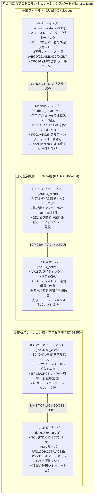

# 産業用電力自動化プロトコルシミュレーションスイート

[English](README.md) | [简体中文](README_zh.md) | [Deutsch](README_de.md) | [Français](README_fr.md) | [Español](README_es.md) | [日本語](README_ja.md) | [한국어](README_ko.md) | [Русский](README_ru.md) | [العربية](README_ar.md)

[](https://flutter.dev)
[](https://dart.dev)
[](https://flutter.dev/desktop)
[](LICENSE)

**Flutter & Dart** でゼロから開発された、クロスプラットフォーム対応の最新産業用電力通信プロトコルシミュレーションシステムです。統一された高コントラスト Material 3 インダストリアル GUI、外部依存関係なしのスタンドアロン CLI エンジン、シームレスなフレームレスウィンドウコントロール、および自動化されたループバック検証テストスイートを提供します。

商用の電力自動化・産業用フィールドバスシミュレータを徹底的にリバースエンジニアリングして再構築し、変電所自動化・配電自動化・現場計装バスの主要規約を **4大コアシステム（全6サブシステム）** で完全網羅しています：

1. **[IEC 60870-5-104 遠方監視制御プロトコルスイート](#1-iec-60870-5-104-遠方監視制御プロトコルスイート)**:
   - サーバ（RTU / 被制御所）：[iec104_server](iec104_server)（`IEC104ServerSimulator` から再構築）
   - クライアント（Master / 制御所）：[iec104_client](iec104_client)（`IEC104ClientSimulator` から再構築）
2. **[Modbus 産業フィールドバススイート](#2-modbus-産業フィールドバススイート)**:
   - スレーブシミュレータ（MSE）：[modbus_slave](modbus_slave)（`ModbusSlaveEmulator` から再構築）
   - マスタシミュレータ（MME）：[modbus_master](modbus_master)（`ModbusMasterEmulator` から再構築）
3. **[IEC 61850 MMS & GOOSE サーバシミュレータ](#3-iec-61850-mms--goose-サーバシミュレータ)**:
   - サーバシミュレータ：[iec61850_server](iec61850_server)（`IEC61850ServerSimulator` から再構築）
4. **[IEC 61850 MMS & GOOSE クライアントシミュレータ](#4-iec-61850-mms--goose-クライアントシミュレータ)**:
   - クライアントシミュレータ：[iec61850_client](iec61850_client)（`IEC61850ClientSimulator` から再構築）

---

## 🌐 17言語のグローバル多言語対応 (i18n)

全6つのアプリケーションすべてにおいて、変電所自動化（IEC 61850 MMS/GOOSE/SCL）や電力 SCADA の標準専門用語に基づく動的な実行時多言語切り替えをサポートしています：

対応言語一覧：
- 🇸🇦 **アラビア語 (ar-SA)** (العربية - 動的RTLミラーレイアウト対応)
- 🇩🇪 **ドイツ語 (de-DE)** (Deutsch)
- 🇺🇸 **英語 (en-US)** (English - デフォルト言語)
- 🇪🇸 **スペイン語 (es-ES)** (Español)
- 🇫🇷 **フランス語 (fr-FR)** (Français)
- 🇮🇳 **ヒンディー語 (hi-IN)** (हिन्दी)
- 🇮🇩 **インドネシア語 (id-ID)** (Bahasa Indonesia)
- 🇮🇹 **イタリア語 (it-IT)** (Italiano)
- 🇯🇵 **日本語 (ja-JP)** (日本語)
- 🇰🇷 **韓国語 (ko-KR)** (한국어)
- 🇵🇱 **ポーランド語 (pl-PL)** (Polski)
- 🇧🇷 **ポルトガル語 (pt-BR)** (Português do Brasil)
- 🇷🇺 **ロシア語 (ru-RU)** (Русский)
- 🇹🇭 **タイ語 (th-TH)** (ไทย)
- 🇹🇷 **トルコ語 (tr-TR)** (Türkçe)
- 🇻🇳 **ベトナム語 (vi-VN)** (Tiếng Việt)
- 🇨🇳 **簡体字中国語 (zh-CN)** (简体中文)

---

## 🎨 統一フレームレス産業用 GUI デザイン

- **専用ブランドアイコン**：各プロトコルのシンボルロゴをタイトルバー左上に配置。
- **シームレスなウィンドウ操作部**：OS標準の太い枠線を非表示にし、最小化・最大化・閉じるボタンをツールバーへ自然に統合。
- **ドラッグ可能なウィンドウバー**：複数モニター環境でもタイトルバーを自由にドラッグ可能。
- **ダーク＆ライトテーマ**：高コントラストのインダストリアルダークモードとオフィス向けライトモードを瞬時に切り替え可能。

---

## 🖥️ 6大アプリケーション画面ギャラリー (UI Showcase)

| サブシステム | プロトコル種別 | 画面プレビュー |
| :--- | :--- | :--- |
| **[IEC 104 サーバ](iec104_server)** | IEC 60870-5-104 サーバ / RTU | [](iec104_server) |
| **[IEC 104 クライアント](iec104_client)** | IEC 60870-5-104 マスタ / 制御所 | [](iec104_client) |
| **[Modbus スレーブ](modbus_slave)** | Modbus TCP / RTU / UDP スレーブ (MSE) | [](modbus_slave) |
| **[Modbus マスタ](modbus_master)** | Modbus TCP / RTU / UDP マスタ (MME) | [](modbus_master) |
| **[IEC 61850 サーバ](iec61850_server)** | IEC 61850 MMS / GOOSE / SCL サーバ | [](iec61850_server) |
| **[IEC 61850 クライアント](iec61850_client)** | IEC 61850 オンライン探索・診断クライアント | [](iec61850_client) |

---

## 🏗️ 全体アーキテクチャと通信概要



---

## 🌟 主要システム詳細仕様

### 1. IEC 60870-5-104 遠方監視制御プロトコルスイート

- **プロジェクトパス**:
  - サーバ：[iec104_server](iec104_server)
  - クライアント：[iec104_client](iec104_client)

#### 📸 ソフトウェア画面プレビュー

##### IEC 104 サーバ（RTU / 被制御所シミュレータ）

> **画面概要**: 複数ソケット接続リスナー管理（主系・待機系 2404 ポート）、局番共通アドレス (COA) 設定、APCI リンクタイマー ($t_0..t_3, k, w$) 調整、一括セルテスト機能を搭載。

##### IEC 104 クライアント（マスタ / 制御所シミュレータ）

> **画面概要**: 接続先エイリアス管理、総呼出 (`C_IC_NA_1`)・時刻同期 (`C_CS_NA_1`)・電力量パルス呼出のワンクリック実行、自動接続時ハンドシェイク設定を提供。

---

### 2. Modbus 産業フィールドバススイート

- **プロジェクトパス**:
  - スレーブ (MSE)：[modbus_slave](modbus_slave)
  - マスタ (MME)：[modbus_master](modbus_master)

#### 📸 ソフトウェア画面プレビュー

##### Modbus スレーブシミュレータ (MSE)

> **画面概要**: コイル・離散入力・保持レジスタ・入力レジスタの監視表、正弦波・三角波・ランダムウォークによる波形シミュレーションエンジンを搭載。

##### Modbus マスタシミュレータ (MME)

> **画面概要**: マルチスレーブ巡回監視コンソール、ビット診断用16ビットバイナリ展開表示、4大工業バイト順 (`ABCD`, `CDAB`, `BADC`, `DCBA`) のワンクリック切り替え。

---

### 3. IEC 61850 MMS & GOOSE サーバシミュレータ

- **プロジェクトパス**: [iec61850_server](iec61850_server)

#### 📸 ソフトウェア画面プレビュー


> **画面概要**: SCLモデルツリー (IED/LD/LN/DO/DA)、品質ビット (Quality) とタイムスタンプ付きリアルタイム計測値モニタ、波形シミュレータと変電所標準 CDC 辞書。

---

### 4. IEC 61850 MMS & GOOSE クライアントシミュレータ

- **プロジェクトパス**: [iec61850_client](iec61850_client)

#### 📸 ソフトウェア画面プレビュー


> **画面概要**: オンラインモデル探索 (Online Discovery)、計測ポイント収集と SBO 遠隔制御パネル、BRCB/URCB レポート管理、LAN GOOSE パケットモニタ。

---

## 📊 サブプロジェクト・成果物マトリクス

| サブプロジェクト | プロトコル役割 | GUI 形態 | スタンドアロン CLI | リリースパス |
| :--- | :--- | :--- | :--- | :--- |
| [iec104_server](iec104_server) | IEC 104 サーバ / RTU | Flutter Desktop / Web | `build/iec104_server` | `iec104_server/build/linux/x64/release/bundle/` |
| [iec104_client](iec104_client) | IEC 104 クライアント / マスタ | Flutter Desktop / Web | `build/iec104_client` | `iec104_client/build/linux/x64/release/bundle/` |
| [modbus_slave](modbus_slave) | Modbus TCP/RTU スレーブ | Flutter Desktop | 純 Dart エンジン | `modbus_slave/build/linux/x64/release/bundle/` |
| [modbus_master](modbus_master) | Modbus TCP/RTU マスタ | Flutter Desktop | 純 Dart 仮想マスタ | `modbus_master/build/linux/x64/release/bundle/` |
| [iec61850_server](iec61850_server) | IEC 61850 MMS/GOOSE サーバ | Flutter Desktop | `build/iec61850_server_cli` | `iec61850_server/build/linux/x64/release/bundle/` |
| [iec61850_client](iec61850_client) | IEC 61850 MMS/GOOSE クライアント | Flutter Desktop | `build/iec61850_client_cli` | `iec61850_client/build/linux/x64/release/bundle/` |

---

## 🚀 クイックスタート

```bash
# 1. デスクトップ GUI の起動（例：Modbus マスタ）
cd modbus_master
flutter run -d linux

# 2. CUI コマンドラインモードの起動（例：IEC 104 サーバ）
cd iec104_server && dart run bin/server.dart --port 2404
```

---

## 📄 ライセンス

本プロジェクトは [MIT ライセンス](LICENSE) のもとで公開されています。
