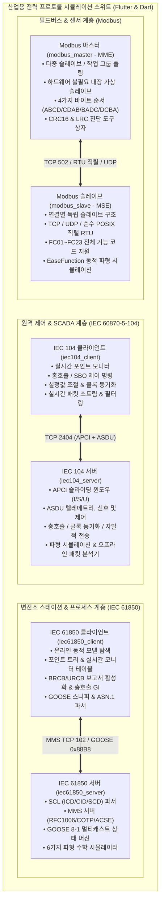

# 산업용 전력 자동화 프로토콜 시뮬레이션 스위트

[English](README.md) | [简体中文](README_zh.md) | [Deutsch](README_de.md) | [Français](README_fr.md) | [Español](README_es.md) | [日本語](README_ja.md) | [한국어](README_ko.md) | [Русский](README_ru.md) | [العربية](README_ar.md)

[](https://flutter.dev)
[](https://dart.dev)
[](https://flutter.dev/desktop)
[](LICENSE)

**Flutter 및 Dart**로 자체 개발된 최신 크로스 플랫폼 산업용 전력 통신 프로토콜 시뮬레이션 시스템입니다. 고대비 Material 3 인더스트리얼 데스크톱 GUI, 외부 종속성이 없는 독립형 CLI 엔진, 세련된 프레임리스 윈도우 컨트롤 및 자동화된 폐루프 검증 테스트 스위트를 제공합니다.

상용 전력 자동화 및 산업용 필드버스 시뮬레이터 소프트웨어를 리버스 엔지니어링하여 변전소 자동화, 배전 자동화 및 필드버스 통신 규약을 **4대 핵심 아키텍처(총 6개 완전 기능 서브시스템)**로 완벽 구현했습니다:

1. **[IEC 60870-5-104 원격 제어 프로토콜 스위트](#1-iec-60870-5-104-원격-제어-프로토콜-스위트)**:
   - 서버 (RTU / 종속국): [iec104_server](iec104_server) (`IEC104ServerSimulator` 역공학 재구축)
   - 클라이언트 (Master / 제어국): [iec104_client](iec104_client) (`IEC104ClientSimulator` 역공학 재구축)
2. **[Modbus 필드버스 시뮬레이션 스위트](#2-modbus-필드버스-시뮬레이션-스위트)**:
   - 슬레이브 시뮬레이터 (MSE): [modbus_slave](modbus_slave) (`ModbusSlaveEmulator` 역공학 재구축)
   - 마스터 시뮬레이터 (MME): [modbus_master](modbus_master) (`ModbusMasterEmulator` 역공학 재구축)
3. **[IEC 61850 MMS & GOOSE 서버 시뮬레이터](#3-iec-61850-mms--goose-서버-시뮬레이터)**:
   - 서버 시뮬레이터: [iec61850_server](iec61850_server) (`IEC61850ServerSimulator` 역공학 재구축)
4. **[IEC 61850 MMS & GOOSE 클라이언트 시뮬레이터](#4-iec-61850-mms--goose-클라이언트-시뮬레이터)**:
   - 클라이언트 시뮬레이터: [iec61850_client](iec61850_client) (`IEC61850ClientSimulator` 역공학 재구축)

---

## 🌐 17개 글로벌 언어 국제화 (i18n)

6개 애플리케이션 전체에서 전력 시스템, SCADA 및 변전소 자동화(IEC 61850 MMS/GOOSE/SCL) 표준 용어 기반의 런타임 다국어 동적 전환을 완벽 지원합니다:

지원 언어 목록:
- 🇸🇦 **아랍어 (ar-SA)** (العربية - 동적 RTL 미러 레이아웃 지원)
- 🇩🇪 **독일어 (de-DE)** (Deutsch)
- 🇺🇸 **영어 (en-US)** (English - 기본값)
- 🇪🇸 **스페인어 (es-ES)** (Español)
- 🇫🇷 **프랑스어 (fr-FR)** (Français)
- 🇮🇳 **힌디어 (hi-IN)** (हिन्दी)
- 🇮🇩 **인도네시아어 (id-ID)** (Bahasa Indonesia)
- 🇮🇹 **이탈리아어 (it-IT)** (Italiano)
- 🇯🇵 **일본어 (ja-JP)** (日本語)
- 🇰🇷 **한국어 (ko-KR)** (한국어)
- 🇵🇱 **폴란드어 (pl-PL)** (Polski)
- 🇧🇷 **포르투갈어 (pt-BR)** (Português do Brasil)
- 🇷🇺 **러시아어 (ru-RU)** (Русский)
- 🇹🇭 **태국어 (th-TH)** (ไทย)
- 🇹🇷 **튀르키예어 (tr-TR)** (Türkçe)
- 🇻🇳 **베트남어 (vi-VN)** (Tiếng Việt)
- 🇨🇳 **간체 중국어 (zh-CN)** (简体中文)

---

## 🎨 일체형 프레임리스 산업용 GUI 디자인

- **전용 브랜드 아이콘**: 각 프로토콜 전용 로고 아이콘이 타이틀바 좌측 상단에 표시됩니다.
- **네이티브 프레임리스 제어**: 운영체제 기본 타이틀바를 숨기고 최소화, 최대화/복원, 닫기 버튼이 상단 툴바에 매끄럽게 통합되었습니다.
- **창 이동 지원**: 다중 모니터 환경에서도 타이틀바 영역을 부드럽게 드래그하여 이동할 수 있습니다.
- **다크/라이트 테마**: 고대비 다크 모드와 라이트 모드를 원클릭으로 전환하며 설정을 자동 영속화합니다.

---

## 🖥️ 6대 애플리케이션 화면 갤러리 (UI Showcase)

| 서브시스템 | 프로토콜 역할 | 인터페이스 화면 미리보기 |
| :--- | :--- | :--- |
| **[IEC 104 서버](iec104_server)** | IEC 60870-5-104 서버 / RTU | [](iec104_server) |
| **[IEC 104 클라이언트](iec104_client)** | IEC 60870-5-104 마스터 / 관제센터 | [](iec104_client) |
| **[Modbus 슬레이브 시뮬레이터](modbus_slave)** | Modbus TCP / RTU / UDP 슬레이브 (MSE) | [](modbus_slave) |
| **[Modbus 마스터 시뮬레이터](modbus_master)** | Modbus TCP / RTU / UDP 마스터 (MME) | [](modbus_master) |
| **[IEC 61850 서버](iec61850_server)** | IEC 61850 MMS / GOOSE / SCL 서버 | [](iec61850_server) |
| **[IEC 61850 클라이언트](iec61850_client)** | IEC 61850 온라인 모델 탐색 및 제어 | [](iec61850_client) |

---

## 🏗️ 전체 아키텍처 및 통신 개요



---

## 🌟 핵심 시스템 세부 사양

### 1. IEC 60870-5-104 원격 제어 프로토콜 스위트

- **서브프로젝트 경로**:
  - 서버: [iec104_server](iec104_server)
  - 클라이언트: [iec104_client](iec104_client)

#### 📸 소프트웨어 화면 미리보기

##### IEC 104 서버 (RTU / 종속국 시뮬레이터)

> **개요**: 다중 리스너 소켓 관리(포트 2404 주/예비), 국번 공통 주소(COA) 관리, APCI 통신 파라미터($t_0..t_3, k, w$) 실시간 조절 및 자체 테스트 지원.

##### IEC 104 클라이언트 (마스터 / 제어국 시뮬레이터)

> **개요**: 연결 별칭 관리, 총호출(`C_IC_NA_1`), 클록 동기화(`C_CS_NA_1`), 전력량 펄스 호출 원클릭 실행 및 자동 연결 핸드셰이크 전략 설정.

---

### 2. Modbus 필드버스 시뮬레이션 스위트

- **서브프로젝트 경로**:
  - 슬레이브 (MSE): [modbus_slave](modbus_slave)
  - 마스터 (MME): [modbus_master](modbus_master)

#### 📸 소프트웨어 화면 미리보기

##### Modbus 슬레이브 시뮬레이터 (MSE)

> **개요**: 코일, 이산 입력, 홀딩 및 입력 레지스터 모니터링 테이블, 정현파·삼각파·랜덤 워크 동적 파형 시뮬레이터 탑재.

##### Modbus 마스터 시뮬레이터 (MME)

> **개요**: 다중 슬레이브 주기적/단일 폴링 콘솔, 비트 진단용 16비트 바이너리 비트 표시, 4가지 산업용 엔디안(`ABCD`, `CDAB`, `BADC`, `DCBA`) 즉시 전환.

---

### 3. IEC 61850 MMS & GOOSE 서버 시뮬레이터

- **서브프로젝트 경로**: [iec61850_server](iec61850_server)

#### 📸 소프트웨어 화면 미리보기


> **개요**: SCL 모델 트리(IED/LD/LN/DO/DA), 품질 플래그(Quality)와 타임스탬프를 포함한 실시간 값 모니터링, 파형 생성기 및 변전소 표준 CDC 메타데이터 사전.

---

### 4. IEC 61850 MMS & GOOSE 클라이언트 시뮬레이터

- **서브프로젝트 경로**: [iec61850_client](iec61850_client)

#### 📸 소프트웨어 화면 미리보기


> **개요**: 온라인 모델 자동 탐색(Online Discovery), 실시간 포인트 폴링 및 SBO 원격 제어 패널, BRCB/URCB 보고서 관리 및 GOOSE 패킷 스니퍼.

---

## 📊 서브프로젝트 및 빌드 산출물 매트릭스

| 서브프로젝트 | 프로토콜 역할 | GUI 형태 | 독립형 CLI 바이너리 | 릴리스 배포 경로 |
| :--- | :--- | :--- | :--- | :--- |
| [iec104_server](iec104_server) | IEC 104 서버 / RTU | Flutter Desktop / Web | `build/iec104_server` | `iec104_server/build/linux/x64/release/bundle/` |
| [iec104_client](iec104_client) | IEC 104 클라이언트 / 마스터 | Flutter Desktop / Web | `build/iec104_client` | `iec104_client/build/linux/x64/release/bundle/` |
| [modbus_slave](modbus_slave) | Modbus TCP/RTU 슬레이브 | Flutter Desktop | 순수 Dart 엔진 | `modbus_slave/build/linux/x64/release/bundle/` |
| [modbus_master](modbus_master) | Modbus TCP/RTU 마스터 | Flutter Desktop | 순수 Dart 가상 마스터 | `modbus_master/build/linux/x64/release/bundle/` |
| [iec61850_server](iec61850_server) | IEC 61850 MMS/GOOSE 서버 | Flutter Desktop | `build/iec61850_server_cli` | `iec61850_server/build/linux/x64/release/bundle/` |
| [iec61850_client](iec61850_client) | IEC 61850 MMS/GOOSE 클라이언트 | Flutter Desktop | `build/iec61850_client_cli` | `iec61850_client/build/linux/x64/release/bundle/` |

---

## 🚀 빠른 시작 안내

```bash
# 1. 데스크톱 GUI 실행 (예: Modbus 마스터)
cd modbus_master
flutter run -d linux

# 2. CLI 무두 모드 실행 (예: IEC 104 서버)
cd iec104_server && dart run bin/server.dart --port 2404
```

---

## 📄 라이선스

본 프로젝트는 [MIT 라이선스](LICENSE)에 따라 오픈 소스로 배포됩니다.
