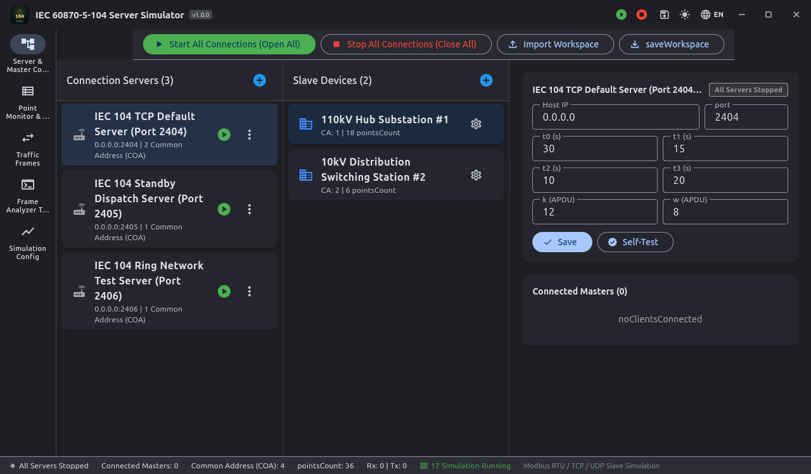
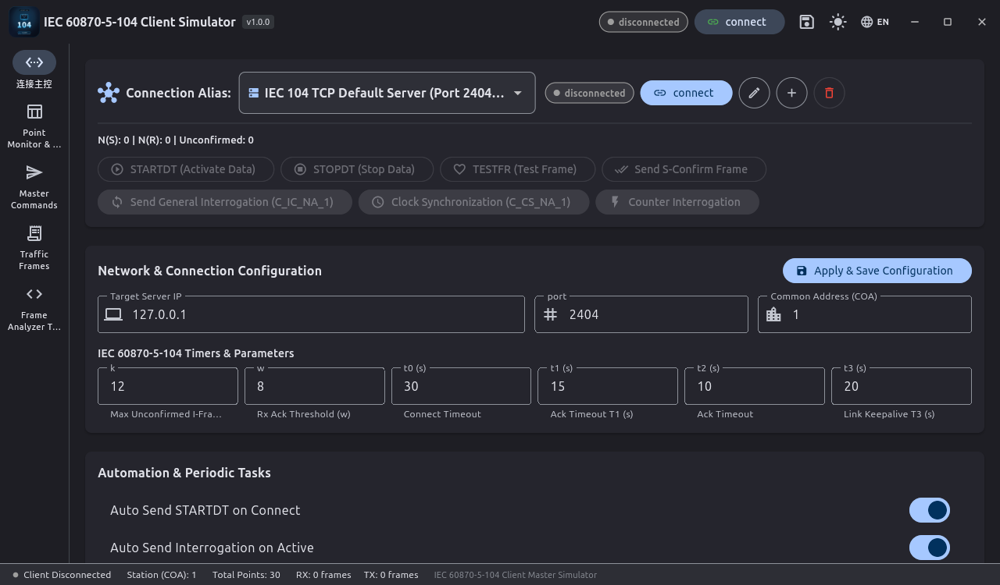
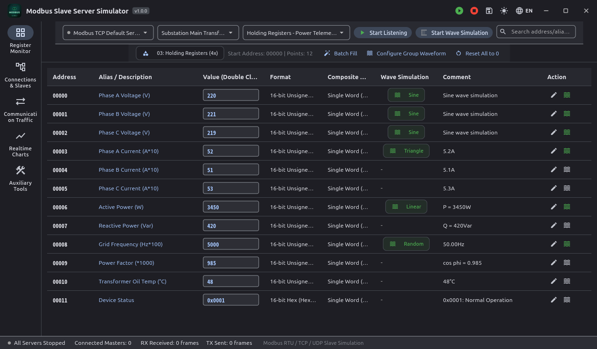
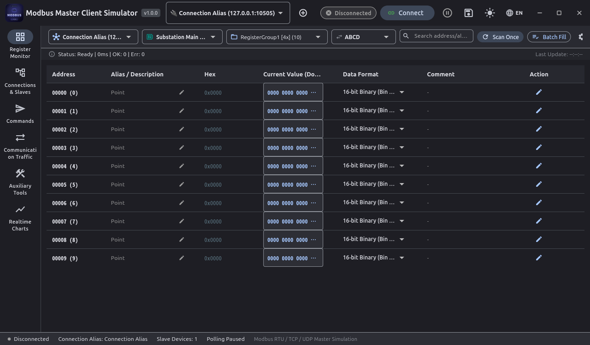

# Программный комплекс имитации промышленных протоколов автоматизации электроэнергетики

[English](README.md) | [简体中文](README_zh.md) | [Deutsch](README_de.md) | [Français](README_fr.md) | [Español](README_es.md) | [日本語](README_ja.md) | [한국어](README_ko.md) | [Русский](README_ru.md) | [العربية](README_ar.md)

[](https://flutter.dev)
[](https://dart.dev)
[](https://flutter.dev/desktop)
[](LICENSE)

Современный кроссплатформенный комплекс для моделирования промышленных протоколов автоматизации энергосистем, полностью разработанный на **Flutter и Dart**. Комплекс предоставляет высококонтрастный графический интерфейс Material 3 в индустриальном стиле, автономные консольные движки (CLI) без внешних зависимостей, нативную интеграцию безрамочного управления окнами и автоматизированные тесты замкнутого контура.

Посредством реверс-инжиниринга и модернизации коммерческих симуляторов протоколов телемеханики и полевых шин данный комплекс охватывает автоматизацию подстанций, распределительных сетей и полевого оборудования в рамках **4 ключевых архитектурных направлений (всего 6 полнофункциональных подсистем)**:

1. **[Комплекс телемеханики IEC 60870-5-104](#1-комплекс-телемеханики-iec-60870-5-104)**:
   - Сервер (RTU / Контролируемый пункт): [iec104_server](iec104_server) (Модернизированный `IEC104ServerSimulator`)
   - Клиент (Мастер / Диспетчерский пункт SCADA): [iec104_client](iec104_client) (Модернизированный `IEC104ClientSimulator`)
2. **[Комплекс полевой шины Modbus](#2-комплекс-полевой-шины-modbus)**:
   - Имитатор ведомого устройства (MSE): [modbus_slave](modbus_slave) (Модернизированный `ModbusSlaveEmulator`)
   - Имитатор ведущего устройства (MME): [modbus_master](modbus_master) (Модернизированный `ModbusMasterEmulator`)
3. **[Сервер-имитатор IEC 61850 MMS & GOOSE](#3-сервер-имитатор-iec-61850-mms--goose)**:
   - Сервер IEC 61850: [iec61850_server](iec61850_server) (Модернизированный `IEC61850ServerSimulator`)
4. **[Клиент-имитатор IEC 61850 MMS & GOOSE](#4-клиент-имитатор-iec-61850-mms--goose)**:
   - Клиент IEC 61850: [iec61850_client](iec61850_client) (Модернизированный `IEC61850ClientSimulator`)

---

## 🌐 Интернационализация на 17 языков (i18n)

Все 6 приложений поддерживают динамическое переключение языка интерфейса во время выполнения с использованием отраслевой терминологии SCADA, автоматизации подстанций (IEC 61850 MMS/GOOSE/SCL) и релейной защиты:

Поддерживаемые языки:
- 🇸🇦 **Арабский (ar-SA)** (العربية - с поддержкой динамической зеркальной верстки RTL)
- 🇩🇪 **Немецкий (de-DE)** (Deutsch)
- 🇺🇸 **Английский (en-US)** (English - язык по умолчанию)
- 🇪🇸 **Испанский (es-ES)** (Español)
- 🇫🇷 **Французский (fr-FR)** (Français)
- 🇮🇳 **Хинди (hi-IN)** (हिन्दी)
- 🇮🇩 **Индонезийский (id-ID)** (Bahasa Indonesia)
- 🇮🇹 **Итальянский (it-IT)** (Italiano)
- 🇯🇵 **Японский (ja-JP)** (日本語)
- 🇰🇷 **Корейский (ko-KR)** (한국어)
- 🇵🇱 **Польский (pl-PL)** (Polski)
- 🇧🇷 **Португальский (pt-BR)** (Português do Brasil)
- 🇷🇺 **Русский (ru-RU)** (Русский)
- 🇹🇭 **Тайский (th-TH)** (ไทย)
- 🇹🇷 **Турецкий (tr-TR)** (Türkçe)
- 🇻🇳 **Вьетнамский (vi-VN)** (Tiếng Việt)
- 🇨🇳 **Упрощенный китайский (zh-CN)** (简体中文)

---

## 🎨 Безрамочный индустриальный интерфейс

- **Фирменные значки приложений**: Индивидуальный логотип протокола в левом верхнем углу заголовка.
- **Интегрированное управление окном**: Замена системных рамок эргономичными кнопками сворачивания, разворачивания и закрытия в панели инструментов.
- **Перетаскивание окна**: Свободное перемещение окна мышью за область заголовка на нескольких мониторах.
- **Темная и светлая темы**: Мгновенное переключение между высококонтрастной индустриальной темной темой и светлой темой с сохранением состояния.

---

## 🖥️ Галерея 6 приложений комплекса (UI Showcase)

| Подсистема | Роль протокола | Внешний вид интерфейса |
| :--- | :--- | :--- |
| **[Сервер IEC 104](iec104_server)** | Сервер IEC 60870-5-104 / КП | [](iec104_server) |
| **[Клиент IEC 104](iec104_client)** | Мастер IEC 60870-5-104 / ПУ | [](iec104_client) |
| **[Имитатор ведомого Modbus](modbus_slave)** | Modbus TCP / RTU / UDP Slave (MSE) | [](modbus_slave) |
| **[Имитатор мастера Modbus](modbus_master)** | Modbus TCP / RTU / UDP Master (MME) | [](modbus_master) |
| **[Сервер IEC 61850](iec61850_server)** | Сервер IEC 61850 MMS / GOOSE / SCL | [](iec61850_server) |
| **[Клиент IEC 61850](iec61850_client)** | Клиент поиска моделей и диагностики | [](iec61850_client) |

---

## 🏗️ Архитектура комплекса и схема взаимодействия

```mermaid
flowchart TB
    subgraph Suite["Программный комплекс имитации протоколов (Flutter & Dart)"]
        subgraph Substation["Уровень подстанции и процесса (IEC 61850)"]
            S61850["Сервер IEC 61850 (iec61850_server)<br/>• Парсер файлов SCL (ICD/CID/SCD)<br/>• Сервер MMS (RFC1006/COTP/ACSE)<br/>• Автомат состояний GOOSE 8-1 Multicast<br/>• 6 математических генераторов сигналов"]
            C61850["Клиент IEC 61850 (iec61850_client)<br/>• Динамическое обнаружение моделей по сети<br/>• Дерево объектов и таблица телеметрии<br/>• Включение BRCB/URCB и общий опрос GI<br/>• Сниффер GOOSE и разбор ASN.1"]
            C61850 <== "MMS TCP 102 / GOOSE 0x88B8" ==> S61850
        end

        subgraph Telecontrol["Уровень телемеханики и SCADA (IEC 60870-5-104)"]
            S104["Сервер IEC 104 (iec104_server)<br/>• Скользящее окно APCI (I/S/U)<br/>• ASDU ТИТ, ТС, ТУ и интегральные суммы<br/>• Общий опрос / Синхронизация времени<br/>• Моделирование сигналов и Hex-анализатор"]
            C104["Клиент IEC 104 (iec104_client)<br/>• Мониторинг точек телемеханики онлайн<br/>• Общий опрос / Двухэтапное ТУ (SBO)<br/>• Регулирование уставок и синхро времени<br/>• Трассировка потока кадров и фильтры"]
            C104 <== "TCP 2404 (APCI + ASDU)" ==> S104
        end

        subgraph Fieldbus["Полевые шины и датчики (Modbus)"]
            MSlave["Ведомый Modbus (modbus_slave - MSE)<br/>• Архитектура изолированных узлов на канал<br/>• TCP / UDP / Прямой POSIX Serial RTU<br/>• Полная поддержка кодов функций FC01-FC23<br/>• Динамические формы волн EaseFunction"]
            MMaster["Мастер Modbus (modbus_master - MME)<br/>• Опрос множества ведомых и групп задач<br/>• Встроенный виртуальный ведомый узел<br/>• 4 порядка байтов (ABCD/CDAB/BADC/DCBA)<br/>• Диагностический калькулятор CRC16 и LRC"]
            MMaster <== "TCP 502 / RTU Serial / UDP" ==> MSlave
        end
    end
```



---

## 🌟 Спецификации основных систем

### 1. Комплекс телемеханики IEC 60870-5-104

- **Пути подпроектов**:
  - Сервер: [iec104_server](iec104_server)
  - Клиент: [iec104_client](iec104_client)

#### 📸 Скриншоты интерфейса

##### Сервер IEC 104 (Имитатор RTU / КП)

> **Обзор**: Управление сокетами прослушивания (порт 2404 основной и резервный канал), общий адрес станции (COA), регулировка параметров APCI ($t_0..t_3, k, w$) и встроенный тест замкнутого цикла.

##### Клиент IEC 104 (Имитатор диспетчерского мастера)

> **Обзор**: Управление псевдонимами соединений, посылка общего опроса (`C_IC_NA_1`), синхронизация времени (`C_CS_NA_1`), опрос счетчиков и автоматические политики подключения.

---

### 2. Комплекс полевой шины Modbus

- **Пути подпроектов**:
  - Ведомый (MSE): [modbus_slave](modbus_slave)
  - Мастер (MME): [modbus_master](modbus_master)

#### 📸 Скриншоты интерфейса

##### Имитатор ведомого Modbus (MSE)

> **Обзор**: Матрица контроля катушек, дискретных входов, входных и регистров хранения; генератор динамических колебаний (синус, треугольник, пила, случайное блуждание).

##### Имитатор мастера Modbus (MME)

> **Обзор**: Консоль циклического и разового опроса, 16-битное бинарное представление регистров для побитовой диагностики и переключение 4 форматов порядка байтов (`ABCD`, `CDAB`, `BADC`, `DCBA`).

---

### 3. Сервер-имитатор IEC 61850 MMS & GOOSE

- **Путь подпроекта**: [iec61850_server](iec61850_server)

#### 📸 Скриншоты интерфейса


> **Обзор**: Дерево модели SCL (IED/LD/LN/DO/DA), мониторинг данных с атрибутами качества и временными метками, математические генераторы сигналов и словарь классов CDC.

---

### 4. Клиент-имитатор IEC 61850 MMS & GOOSE

- **Путь подпроекта**: [iec61850_client](iec61850_client)

#### 📸 Скриншоты интерфейса


> **Обзор**: Динамический поиск моделей по сети (Online Discovery), панели телеуправления SBO, управление блоками отчетов BRCB/URCB и анализатор GOOSE.

---

## 📊 Матрица подпроектов и сборок

| Подпроект | Роль | Тип интерфейса | Автономный CLI бинарник | Каталог сборки |
| :--- | :--- | :--- | :--- | :--- |
| [iec104_server](iec104_server) | Сервер IEC 104 / КП | Flutter Desktop / Web | `build/iec104_server` | `iec104_server/build/linux/x64/release/bundle/` |
| [iec104_client](iec104_client) | Клиент IEC 104 / ПУ | Flutter Desktop / Web | `build/iec104_client` | `iec104_client/build/linux/x64/release/bundle/` |
| [modbus_slave](modbus_slave) | Ведомый Modbus TCP/RTU | Flutter Desktop | Чистый Dart | `modbus_slave/build/linux/x64/release/bundle/` |
| [modbus_master](modbus_master) | Мастер Modbus TCP/RTU | Flutter Desktop | Чистый Dart | `modbus_master/build/linux/x64/release/bundle/` |
| [iec61850_server](iec61850_server) | Сервер IEC 61850 | Flutter Desktop | `build/iec61850_server_cli` | `iec61850_server/build/linux/x64/release/bundle/` |
| [iec61850_client](iec61850_client) | Клиент IEC 61850 | Flutter Desktop | `build/iec61850_client_cli` | `iec61850_client/build/linux/x64/release/bundle/` |

---

## 🚀 Быстрый старт

```bash
# 1. Запуск десктопного GUI (на примере Modbus Master)
cd modbus_master
flutter run -d linux

# 2. Запуск в консольном режиме без графики (на примере IEC 104 Server)
cd iec104_server && dart run bin/server.dart --port 2404
```

---

## 📄 Лицензия

Проект распространяется под открытой лицензией [MIT License](LICENSE).
