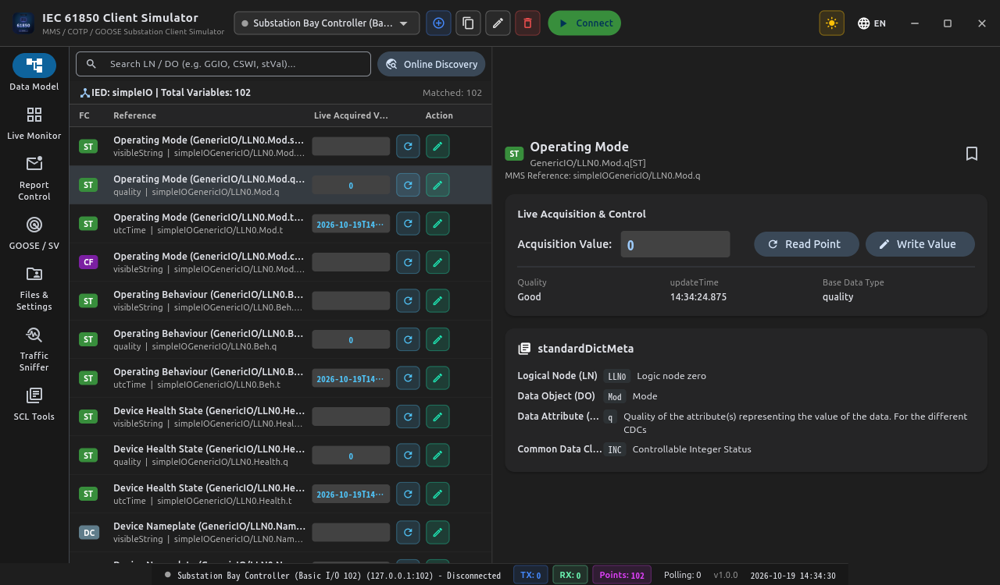

# IEC 61850 Client Simulator (MMS & GOOSE - Flutter & Dart)

[English](README.md) | [简体中文](README_zh.md)

[](https://flutter.dev)
[](https://flutter.dev/desktop)
[](https://en.wikipedia.org/wiki/IEC_61850)

A modern, cross-platform **IEC 61850 MMS & GOOSE Client Simulator** re-engineered from `IEC61850ClientSimulator` using pure **Flutter & Dart**.



---

## 🌟 7 Core Application Modules

1. 🌲 **Model Explorer**: Hierarchical IED / LD / LN / DO / DA tree navigation, point attribute inspection, manual read/write, and SBO control dialogs.
2. 📊 **Data Monitor**: Batch polling monitor table with Quality flags (Good, Invalid, Overflow, Test) and live value mutation highlighting.
3. 📑 **Report Control Blocks (BRCB / URCB)**: Enable/disable reports (`RptEna`), trigger General Interrogation (`GI`), configure trigger options, and inspect incoming unconfirmed `InformationReport` streams.
4. 🦢 **GOOSE Monitor**: Capture local area network GOOSE broadcast multicasts, display state/sequence counters, and inspect raw hex dumps.
5. 📁 **Files & Settings**: Download remote substation COMTRADE oscillography records (`.cfg`, `.dat`), and switch Active Setting Groups (`ActSG`).
6. 🌐 **Traffic Sniffer**: Wireshark-grade packet recorder displaying timestamp, direction (TX/RX), protocol layer, service name, and split Hex+ASCII dump.
7. 🛠️ **SCL Tools & Dictionaries**: 9 bundled industry standard SCL templates, plus a bilingual reference dictionary for LN, DO, DA, and CDC.

---

## 🚀 Build & Run Guide

```bash
# Launch desktop GUI
flutter run -d linux

# Run headless client CLI with online discovery
dart run bin/client.dart --ip 127.0.0.1 --port 102 --discover

# Run end-to-end verification suite
dart run bin/verify_client.dart
```

---

## 📄 License

This subproject is licensed under the [MIT License](../LICENSE).
