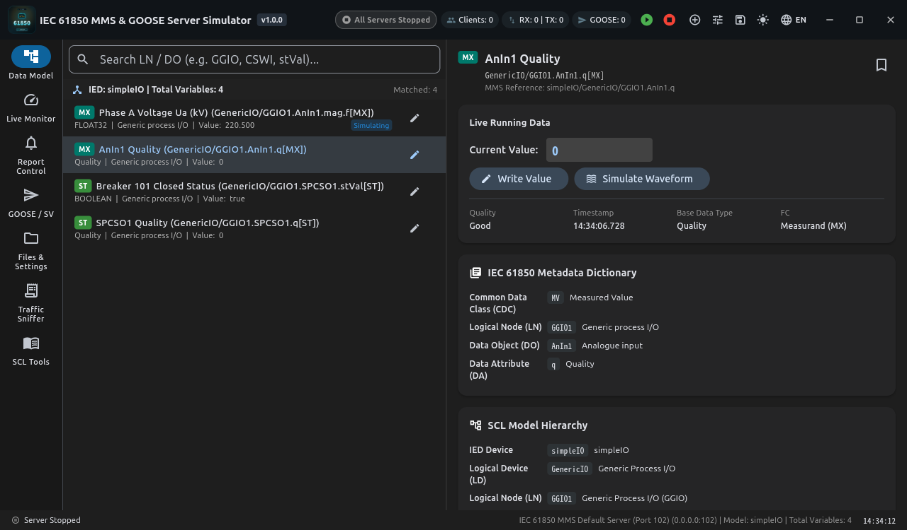

[English](README.md) | [简体中文](README_zh.md)

# IEC 61850 Server Simulator (Flutter 版)

现代化工业级 **IEC 61850 服务端模拟器 (MMS / GOOSE / SCL)**，基于 Flutter 与纯 Dart 协议栈构建。全面复刻并增强了商业版 `IEC61850ServerSimulator` 的核心功能，提供工业级深色/浅色主题、清晰的 NavigationRail 布局、实时报文抓包分析、波形仿真生成器及内置行业标准 ICD 模板库。



---

## 🌟 核心特性与架构

```
┌────────────────────────────────────────────────────────────────────────┐
│                   IEC 61850 Server Simulator 应用层                    │
│   [模型资源树]  [实时数据监视]  [报告控制(BRCB/URCB)]  [GOOSE跳闸组播]  │
│   [MMS文件服务] [定值区控制]    [报文嗅探与Hex分析]   [SCL工具与字典]   │
├────────────────────────────────────────────────────────────────────────┤
│                       服务引擎与仿真驱动层                             │
│   • Iec61850ServerEngine  : MMS 请求分发、变量字典与读写/控制映射      │
│   • GoosePublisherService : GOOSE 8-1 组播引擎与指数退避重发状态机     │
│   • SimulationService     : 正弦波/三角波/方波/锯齿波/累加/随机走动   │
│   • TrafficLogger         : 纳秒级报文流水线与 Wireshark 风格 HexDump  │
├────────────────────────────────────────────────────────────────────────┤
│                         纯 Dart 协议栈实现                             │
│   • Layer 7 : MMS (ISO 9506-1/2) ASN.1 BER 编解码器                    │
│   • Layer 6 : ISO Presentation (X.226) & ACSE (X.227) AARQ / AARE      │
│   • Layer 5 : ISO Session (X.225)                                      │
│   • Layer 4 : ISO 8073 COTP (Class 0 CR / CC / DT 数据传输)            │
│   • Layer 4 : RFC 1006 TPKT (ISO Transport on Top of TCP)              │
│   • Layer 3 : TCP / IP Socket (默认标准端口 102 / 支持用户端口 10102)   │
└────────────────────────────────────────────────────────────────────────┘
```

### 1. 完整工业协议支持
- **RFC 1006 TPKT + ISO 8073 COTP**：支持连接请求（CR）、连接确认（CC）以及数据传输帧（DT）。
- **ACSE 与 MMS 关联握手**：完整支持 AARQ 握手、协商 MMS 协议版本、服务支持位图与嵌套层级，自动回复 ACSE AARE + MMS Initiate Response。
- **MMS 核心服务**：
  - `GetNameList`：支持 VMD / 域名（Logical Device）作用域，查询 NAMED_VARIABLE 与 NAMED_VARIABLE_LIST (DataSet)。
  - `Read`：支持按单个/批量变量读取，支持按 NamedVariableList (DataSet) 批量读取，严格按照 ASN.1 BER 编码各 IEC 基本类型数据（Boolean, Int, Uint, Float32, Float64, UtcTime, Quality, VisibleString）。
  - `Write`：支持更新数据属性，支持对 `Oper.ctlVal` 与 `SBO` 执行开关控制与遥控，更新状态量 `stVal`。
  - `InformationReport`：针对使能的 BRCB / URCB 报告，主动向客户端推送未确认报告（UnconfirmedPdu）。
  - `MMS File Services`：支持 `FileDirectory` 文件浏览、`FileOpen` 打开、`FileRead` 分块读取、`FileClose` 关闭、`FileDelete` 删除。
- **GOOSE (IEC 61850-8-1)**：
  - 支持 GCB 控制块管理、Ethertype 0x88B8 报文封装与 allData 数据集编码。
  - 具备标准的 `stNum` 状态计数与 `sqNum` 序号管理。
  - 支持最小重传时间与最大心跳时间的**指数退避（Exponential Backoff）重传状态机**。
  - 支持在 UI 中一键触发变位事件（`stNum++`、`sqNum=0`、重置快速重传）。
- **SCL (IEC 61850-6) XML 快速解析器**：
  - 支持解析 ICD, CID, SCD, SSD 配置文件。
  - 自动递归展开 `DataTypeTemplates`（LNodeType, DOType, DAType, EnumType）至具体的叶子数据属性。
  - 提取 IED, LDevice, LN, DataSet, FCDA, ReportControl, GSEControl, SampledValueControl, SGCB 定值区。

---

## 📊 与商业旧版 (`IEC61850ServerSimulator`) 功能对比

| 功能模块 | 商业旧版 (C#/C++ 商业软件) | 本开源 Flutter 版本 | 状态 |
| :--- | :--- | :--- | :--- |
| **SCL 文件解析** | 支持 ICD, CID, SCD | 支持 ICD, CID, SCD, SSD，纯 Dart 内存高速解析 | ✅ 全面超越 |
| **MMS 规约引擎** | 依赖第三方闭源 C/C++ 动态库 | 100% 纯 Dart 实现，无外部 C 动态库依赖，跨平台安全 | ✅ 全面重写 |
| **内置标准示例** | 附带 examples 文件夹 | 内置 9 套标准 ICD 模板（包含风电 61400、保护、控制、GOOSE 等） | ✅ 完善附带 |
| **实时变量监视** | 简单树与列表 | 树型资源管理器 + 独立数据监视表，支持关注置顶与多条件筛选 | ✅ 现代化重构 |
| **波形仿真模拟** | 仅商业版提供 EaseFunction | 内置正弦波、三角波、方波、锯齿波、线性累加、随机走动等 6 种波形 | ✅ 完整复刻 |
| **报告控制块** | 支持 BRCB / URCB | 支持参数查看、使能开关、关联数据集浏览、一键触发总召唤 (GI) | ✅ 完整支持 |
| **GOOSE 组播** | 仅基础配置 | 具备动态指数退避状态机、变位事件触发、原始帧 HexDump 分析 | ✅ 完整支持 |
| **MMS 文件服务** | 支持浏览与传输 | 提供工作区目录管理、实时刷新、测试文件生成、删除 | ✅ 完整支持 |
| **定值区 (SGCB)** | 仅显示定值参数 | 支持定值区总数查看、运行区 (ActSG) 快速切换、编辑区 (EditSG) | ✅ 完整支持 |
| **报文嗅探分析** | 简单日志 | Wireshark 级别实时捕获、协议过滤、ASCII/Hex 对照高亮、文本导出 | ✅ 专业增强 |
| **标准元数据字典** | 依赖外部 JSON | 整合 CDC、LN、DO、DA 四级双语字典，支持点击速查与反向检索 | ✅ 完整整合 |
| **无头 CLI 支持** | 无独立轻量 CLI | 提供 `bin/server.dart`，支持纯终端运行与后台服务守护 | ✅ 独家增强 |

---

## 🖥️ 界面功能模块速览

应用采用符合电力监控系统的现代化工业暗色（Dark）与亮色（Light）自适应布局：

1. **模型资源 (Model Explorer)**
   - 左侧为 IED -> Logical Device (LD) -> Logical Node (LN) -> Data Object (DO) -> Data Attribute (DA) 层次树。
   - 支持高亮功能约束角标（`[ST]` 状态量, `[MX]` 遥测量, `[CO]` 控制量, `[SP]` 定值, `[CF]` 配置）。
   - 右侧检查器展示当前属性详情、实时值、品质字（Good/Invalid/Test/Blocked）、更新时间戳，以及 IEC 61850 标准元数据字典解释。
2. **数据监视 (Data Monitor)**
   - 表格形式集中监视重点测点。
   - 提供开关量一键快速切换，模拟量点击弹窗写入。
   - 提供"一键开启全部波形仿真"与"一键停止全部仿真"控制按钮。
3. **报告控制 (Reports BRCB/URCB)**
   - 区分 Buffered（缓存型）与 Unbuffered（非缓存型）控制块。
   - 展示 RptID、DataSet、BufTime、IntgPd、ConfRev、触发选项（dchg, qchg, dupd, period, gi）与可选字段。
   - 提供**一键触发总召唤 (Trigger GI)** 按钮，即刻向上位机推送全站报告。
4. **GOOSE 与采样值 (GOOSE / SV)**
   - 展示 GCB 控制块的 GocbRef、APPID、目标 MAC、minTime/maxTime、stNum、sqNum、发送包数。
   - 提供发布开关与**模拟状态变位 (stNum++)** 按钮。
   - 实时查看最新发出的 Ethertype 88B8 GOOSE 原始报文帧 HexDump。
5. **文件与定值 (Files & Settings)**
   - MMS 文件服务：浏览服务端目录、新建测试录波日志、查看文件大小与修改时间、删除文件。
   - SGCB 定值区控制：支持在 1~16 个定值区中一键切换当前激活定值区 (ActSG)。
6. **报文监视 (Traffic Sniffer)**
   - 实时监听每一包 TPKT, COTP, ACSE, MMS, GOOSE 报文。
   - 支持按 RX / TX 方向过滤，按协议过滤，支持自动滚屏、暂停抓包、清空与导出日志文件。
   - 点击任一报文即可展开 Wireshark 风格的十六进制与 ASCII 侧边栏对照解析。
7. **SCL 工具 (SCL Tools)**
   - 内置 9 套经典 IEC 61850 SCL/ICD 行业模板，支持一键载入并解析为当前服务器模型。
   - 提供 XML 源代码编辑与查看器。
   - 提供 CDC、LN、DO、DA 实时双语字典搜索器。

---

## 🚀 编译与运行指南

### 1. 运行 GUI 桌面应用
```bash
cd iec61850_server

# 获取依赖
flutter pub get

# 启动桌面调试
flutter run -d linux

# 构建 Linux 独立发布版
flutter build linux --release --no-tree-shake-icons
```
编译产物位于：`build/linux/x64/release/bundle/iec61850_server`。

### 2. 运行独立 CLI 无头服务端 (Headless Server)
无需 GUI 界面，可在 Linux 服务器后台或 Docker 容器中直接运行：
```bash
# 直接使用 Dart 运行
dart run bin/server.dart --ip 0.0.0.0 --port 10102 --scl assets/examples/server_example_basic_io.icd

# 或编译为极速二进制可执行文件
dart compile exe bin/server.dart -o build/iec61850_server_cli
./build/iec61850_server_cli --port 10102
```

### 3. 执行自动化测试与规约验证套件
```bash
# 运行单元测试
flutter test

# 运行全链路规约验证测试（包括 Socket 连接、COTP 握手、ACSE AARQ/AARE、MMS GetNameList、Read、Write、GOOSE 发布）
dart run bin/verify_server.dart
```

---

## ⚠️ 关于 Linux 端口 102 权限说明

IEC 61850 MMS 协议标准端口为 **102**。在 Linux 系统中，小于 1024 的端口属于特权端口：
- **普通用户测试**：在界面顶部点击配置，或启动时将端口修改为 **10102** 或 **15502**，即可在非 root 用户下免特权启动。
- **绑定标准 102 端口**：
  - 方式 A：使用 `sudo` 运行编译后的程序。
  - 方式 B（推荐）：为二进制文件授予网络绑定特权能力（无需 root）：
    ```bash
    sudo setcap 'cap_net_bind_service=+ep' build/linux/x64/release/bundle/iec61850_server
    ```

---

## 📁 目录结构

```
iec61850_server/
├── assets/
│   ├── examples/              # 9 套内置标准 SCL / ICD 模型
│   └── json/                  # CDC, LN, DO, DA 标准字典 JSON
├── bin/
│   ├── server.dart            # 独立 CLI 服务端
│   └── verify_server.dart     # 全链路自动化测试与握手验证脚本
├── lib/
│   ├── main.dart              # Flutter 主入口与主题配置
│   └── src/
│       ├── models/            # SCL 模型、数据变量、仿真配置、字典服务
│       ├── protocol/          # TPKT, COTP, ACSE, MMS, GOOSE 规约核心
│       ├── services/          # 波形仿真服务、报文日志服务
│       └── ui/
│           ├── dialogs/       # 数据写入、服务器设置、波形配置弹窗
│           ├── tabs/          # 7 大核心业务 Tab 视图
│           └── home_screen.dart # 现代化工业主界面与 NavigationRail
├── test/
│   └── iec61850_server_test.dart # 完整单元测试集
└── README.md
```
